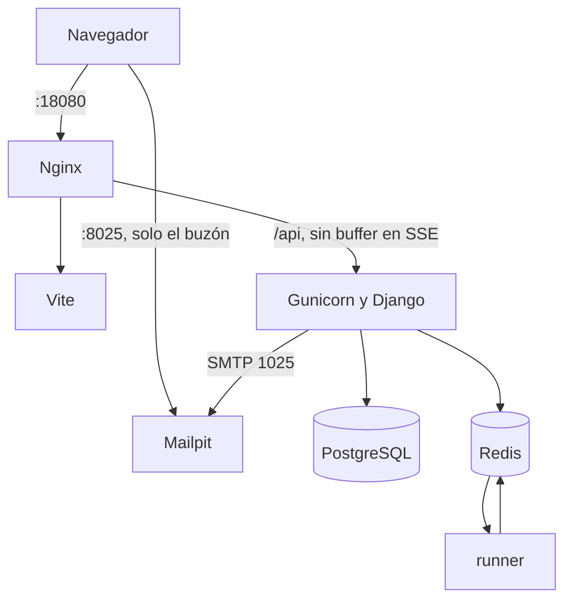
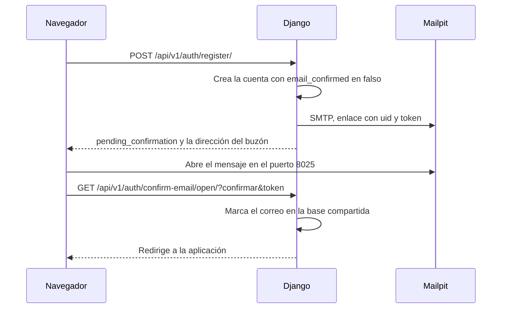
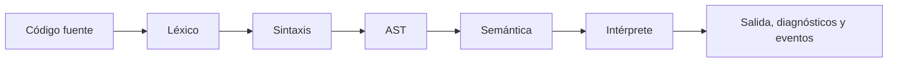
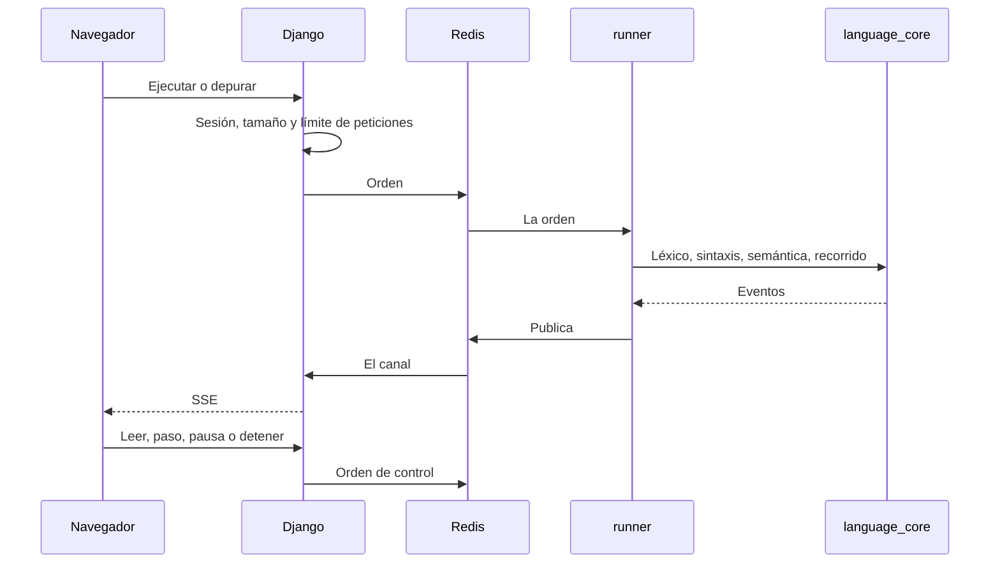
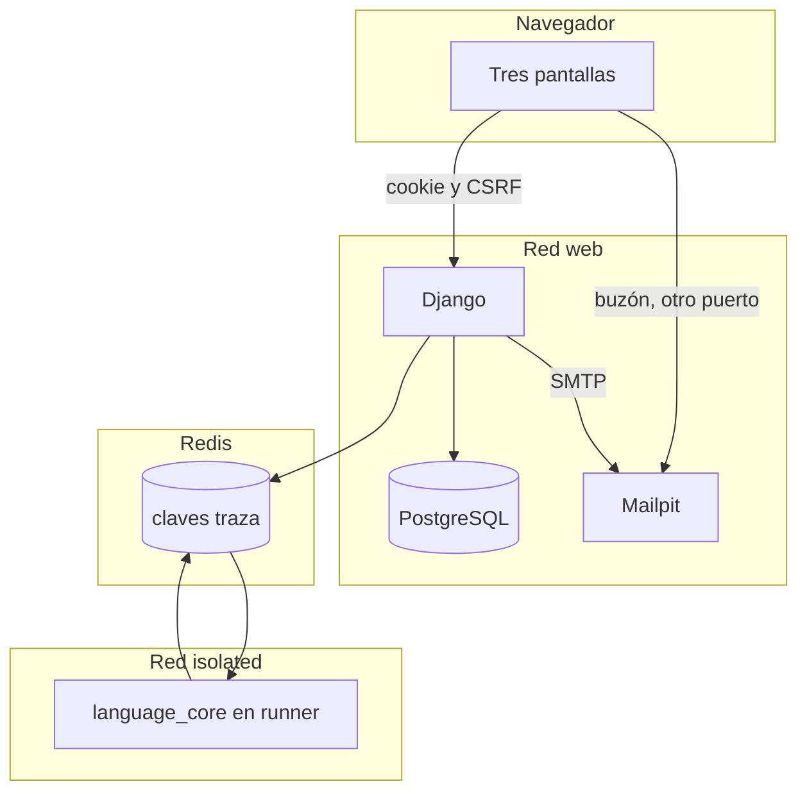

# Arquitectura

Estado: el editor, el laboratorio, el correo de confirmación, el idioma español o inglés, la traducción a otros lenguajes, la aplicación de escritorio, los niveles de suscripción, el bloqueo de pegar y las altas que define el administrador están en el código de desarrollo. Fecha de referencia: 2026-10-21. `DEBUG` sigue en verdadero. `config.settings.production` no lo carga el compose.

Este documento describe el sistema que corre hoy. La gramática está en [gramatica.md](gramatica.md), el árbol en [ast.md](ast.md), las tablas en [modelo-de-datos.md](modelo-de-datos.md) y el aislamiento del intérprete en [ejecucion.md](ejecucion.md).

## 1. Producto

**Aulivana-FCDdesign** enseña programación estructurada. El canónico del lenguaje es el español. La cuenta puede ver la interfaz y las palabras reservadas en inglés. Quien entra escribe pseudocódigo, recibe diagnósticos con línea y columna, lo ejecuta en una consola, lo recorre paso a paso, ve el diagrama generado desde el árbol de sintaxis y puede pedir el mismo algoritmo en Python, JavaScript, TypeScript, Java, C, C++ o C#. Esa traducción no se ejecuta.

Hay tres pantallas, todas con la misma sesión:

| Pantalla | Dónde vive | Qué hace |
| --- | --- | --- |
| Banco de trabajo | `frontend/src/workbench` | Proyectos, algoritmos, editor, depurador, consola, diagrama, comunidades y el repaso de un alumno |
| Laboratorio | `frontend/src/learning` | Ruta Fundamentos, práctica de concurso, banco de retos, rutas de un docente, práctica libre, tablero y avance |
| Armar diagrama | `frontend/src/compose` | Figuras que se arrastran y se convierten en pseudocódigo. El resultado se abre en el editor |

El núcleo cubre secuencia, `Si`, `Segun`, `Mientras`, `Repetir`, `Para`, arreglos, funciones, procedimientos, recursión y la biblioteca estándar. Quedan fuera la orientación a objetos, los archivos del pseudocódigo y la concurrencia. Las actividades y las entregas del aula no tienen tablas. Las comunidades sí: un docente agrupa cuentas que ya existen.

## 2. Contenedores de desarrollo

`compose.yaml` levanta siete servicios. El origen de la aplicación es `http://127.0.0.1:18080`. El buzón es `http://127.0.0.1:8025`.



| Servicio | Red | Sale a internet | Qué guarda |
| --- | --- | --- | --- |
| `nginx` | `web` | el puerto `18080` | nada |
| `frontend` | `web` | no | el árbol del cliente, montado |
| `web` | `web` | no | el árbol del repositorio, montado |
| `mail` | `web` | el puerto `8025` | los mensajes en memoria del proceso, con tope de 500 |
| `db` | `web` | el puerto `5434` | el volumen `traza-db` |
| `redis` | `web` e `isolated` | no | el volumen `traza-redis` |
| `runner` | `isolated`, interna | no | nada en disco. `/tmp` es memoria |

`runner` no tiene credenciales de PostgreSQL, no monta Django y no alcanza el buzón. Redis está en las dos redes y es el único puente. La credencial del runner solo lee y escribe claves `traza:*`.

En la máquina, sin este compose, no hay runner ni Mailpit. Django ejecuta el intérprete en el mismo proceso y el correo se imprime en la consola. El alta entra al momento.

## 3. Principios

1. El lenguaje es el paquete `language_core`. No importa Django, Redis ni el framework web.
2. El pseudocódigo se ejecuta recorriendo un AST. No se usa `eval` ni `exec`. Traducir a otro lenguaje emite un programa y no lo corre.
3. El texto del estudiante se conserva. Las palabras clave se reconocen sin importar mayúsculas ni acentos, y también en su grafía inglesa. El canónico interno sigue en español. Los identificadores sí distinguen acentos. Cambiar el idioma de la cuenta no reescribe un fuente ya guardado.
4. El perfil estricto es el predeterminado.
5. La asignación se escribe `<-`. El signo `=` compara.
6. Cada error lleva código estable, severidad, posición, fragmento y, cuando se puede, una sugerencia.
7. En los contenedores y en la configuración de producción el proceso web no interpreta código de usuarios. Lo hace `runner`.
8. El laboratorio y el editor comparten el mismo AST, el mismo intérprete y el mismo sobre de eventos. Blockly no ejecuta.

## 4. Tecnologías

| Pieza | Elección | Motivo |
| --- | --- | --- |
| Lenguaje | Python 3.12 o superior | Tipado estático usable en el núcleo y en Django |
| Web | Django 5.2 | El usuario propio existe desde la primera migración |
| API | Django REST Framework | Recursos, sesión y errores uniformes |
| Esquema | drf-spectacular | OpenAPI en `GET /api/schema/` |
| Base | PostgreSQL 16 | Integridad, índices parciales y JSON |
| Bus | Redis 7 | Órdenes, eventos, caché y límite de peticiones. Sin Celery. [ADR 0007](adr/0007-ejecucion-sin-celery.md) |
| Correo de desarrollo | Mailpit 1.27 | SMTP interno y buzón visible. No entrega a internet |
| Auth | Sesión de Django y CSRF | Sin JWT. [ADR 0008](adr/0008-usuario-por-correo-y-sesion.md) |
| Niveles | Filas en PostgreSQL | Precio, topes y menús. [ADR 0009](adr/0009-niveles-de-suscripcion.md) |
| Cliente | React, TypeScript y Vite | [ADR 0003](adr/0003-frontend-react-typescript.md) |
| Editor | CodeMirror 6 | [ADR 0004](adr/0004-editor-codemirror-6.md) |
| Diagrama del editor | React Flow | Solo dibuja. Las posiciones salen de `frontend/src/diagram/layout.ts` |
| Bloques | Blockly | Serializa JSON. El adaptador construye el AST existente |
| Borde | Nginx 1.27 | Un origen. `proxy_buffering off` en `/api` |
| Proceso web | Gunicorn | Sirve Django. Reenvía el SSE |

Ajustes: `server/config/settings/base.py`, `development.py`, `test.py` y `production.py`. Los secretos entran por el entorno. `.env.example` no tiene valores de un servidor.

Calidad: Black, Ruff y mypy en el núcleo y en el servidor. pytest y pytest-django contra PostgreSQL. En el cliente, TypeScript, ESLint y Vitest.

## 5. Directorios

```text
fcdesign/
├── compose.yaml
├── deploy/
│   ├── web.Dockerfile
│   ├── web-entrypoint.sh      migra y arranca Gunicorn
│   ├── runner.Dockerfile
│   ├── frontend.Dockerfile
│   ├── nginx/desarrollo.conf
│   └── redis/                 redis.conf y users.acl
├── runner/                    protocolo y worker. No importa Django
├── language_core/             lexer, parser, semántica, intérprete, depurador,
│                              dialect.py, flowchart.py, stdlib.py, translate.py,
│                              block_adapter.py, block_import.py y pseudocode.py
├── local_host/                intérprete en la máquina para la aplicación de escritorio
├── desktop/                   ventana Tauri, proxy de la API y empaquetado
├── server/
│   └── apps/
│       ├── accounts/          usuario, perfil, sesión, confirmación y restablecimiento
│       ├── projects/          proyectos, carpetas, algoritmos, versiones y enlaces
│       ├── executions/        ejecuciones del editor y SSE
│       ├── flowcharts/        API del grafo
│       ├── editor/            preferencias
│       ├── language/          perfiles y palabras clave
│       ├── classroom/         comunidades
│       ├── learning/          ruta, banco, autoría, intentos, práctica y avance
│       └── audit/
└── frontend/src/
    ├── auth/                  alta, entrada, recuperación y enlace de confirmación
    ├── workbench/             banco de trabajo y comunidades
    ├── learning/              laboratorio
    ├── compose/               armar diagrama
    ├── diagram/               figuras, posiciones, SVG, PNG y PDF
    ├── editor/                CodeMirror
    ├── dialect.ts             grafías de las palabras reservadas
    ├── i18n.tsx               textos de la interfaz en español y en inglés
    └── shell/                 nombre, perfil, puntos y puesto
```

## 6. Módulos

| Módulo | Ubicación | Responsabilidad |
| --- | --- | --- |
| Núcleo | `language_core` | Léxico, sintaxis, semántica, interpretación, depuración, diagrama, traducción a otros lenguajes, grafías en inglés y paso entre bloques y texto |
| Anfitrión local | `local_host` | Validar, traducir, ejecutar y depurar en la máquina de la aplicación de escritorio. No abre PostgreSQL |
| Escritorio | `desktop/` | Ventana Tauri. Arranca el anfitrión local y, en un paquete publicado, proxifica `/api` |
| accounts | `server/apps/accounts` | Correo como identificador, confirmación, sesión y recuperación |
| projects | `server/apps/projects` | Proyectos, carpetas, algoritmos, versiones, papelera y enlaces |
| executions | `server/apps/executions` | Una ejecución por algoritmo, eventos persistidos de consola y canal SSE |
| flowcharts | `language_core/flowchart.py` y `server/apps/flowcharts` | Grafo sin coordenadas, y la API que lo entrega |
| editor | `server/apps/editor` y `frontend/src/editor` | Preferencias en el servidor. El editor es del cliente |
| language | `server/apps/language` | Perfiles persistidos y la lista de palabras que consume el cliente |
| classroom | `server/apps/classroom` | Comunidades. Sin actividades ni entregas |
| learning | `server/apps/learning` y `frontend/src/learning` | Rutas, retos, intentos, práctica libre, banco y avance |
| audit | `server/apps/audit` | Alta, confirmación, sesión, enlaces, borrado y ejecución |
| runner | `runner/` | Proceso que consume Redis y llama al núcleo |

El parser y el intérprete no son aplicaciones Django. [ADR 0002](adr/0002-nucleo-independiente-de-django.md).

## 7. Cliente

`App` pide la cookie CSRF y después `GET /api/v1/auth/me/`. Sin sesión muestra `AuthScreen`. Con sesión elige banco de trabajo, laboratorio o armar diagrama. Las tres pantallas comparten la cuenta. Volver al editor conserva el algoritmo que estaba abierto.

El cliente no ejecuta el pseudocódigo del editor. Validar, ejecutar y depurar pasan por el servidor, para que el resaltado no contradiga al intérprete. La lista de palabras sale de `GET /api/v1/language/keywords/`, generada por `grammar.py`. `frontend/src/dialect.ts` muestra la grafía del idioma de la cuenta y sigue ofreciendo la otra en el completado. Los textos de pantalla viven en `frontend/src/i18n.tsx`.

Armar diagrama es distinto: el modelo de figuras vive en el navegador (`frontend/src/compose/model.ts`) y el texto se calcula ahí. Al abrirlo en el editor, el fuente pasa a ser un algoritmo y a partir de ese momento manda el núcleo.

**Actualizar**, en el banco de trabajo y en el laboratorio, vuelve a pedir los datos de la cuenta. En el editor suelta el borrador que aún no se guardó y cierra el canal de la ejecución en curso. La misma cuenta no puede estar abierta en otro equipo: el segundo ingreso responde `session_open`.

## 7.1 Aplicación de escritorio

`desktop/` es una ventana Tauri 2, versión `0.2.0`, identificador `app.traza.desktop`. Al abrir arranca `local_host` en `127.0.0.1`, en un puerto libre, con un token que solo conoce esa ventana. El anfitrión anuncia origen y token por la salida estándar. La ventana los recibe en `window.__TRAZA_LOCAL__`.

Validar, traducir, el diagrama, ejecutar, depurar y las pasadas del laboratorio van a ese proceso. Usan el mismo `language_core` que el runner. No pasan por Redis ni por Gunicorn.

La cuenta, los proyectos y el resto de `/api/v1/` siguen en Django. En un paquete publicado, `__TRAZA_DESKTOP_PROXY__` es verdadero y el comando `server_fetch` reenvía solo rutas que empiezan por `/api/` a `POST /local/v1/proxy`. El origen de esa API es `TRAZA_API_ORIGIN`. Si no está definida, el lanzador usa `http://18.118.112.206:18080`. En depuración el proxy queda apagado y Vite, en el puerto `5174`, habla con la API como el navegador.

Descargar un archivo en la aplicación abre el diálogo de guardar del sistema. En Windows y en Linux un enlace de descarga sobre un blob no deja el archivo. El comando es `save_download`, en `desktop/src-tauri/src/save.rs`, y admite hasta 25 MB. Cancelar el diálogo no guarda nada. Si no se puede escribir, la pantalla dice que no se pudo guardar el archivo. En el navegador la descarga sigue siendo la del propio navegador.

El esquema `Aulivana-FCDdesign:` abre la ventana y entrega el enlace de confirmación o de restablecimiento. `TRAZA_UPDATE_URL`, si existe, apunta a un manifiesto con `version` y `url`. Un paquete más nuevo se descarga aparte. No se borra el directorio de datos de la persona.

El empaquetado está en `.github/workflows/desktop.yml` y se lanza a mano. Cubre Windows x64 y ARM, Mac M e Intel, y Linux x64 y ARM. `desktop/scripts/sign.sh` firma cuando hay certificado. En macOS esa firma evita que el sistema marque el paquete como dañado.

## 7.2 Traducción

`translate_source` compila con el perfil del algoritmo. Sin errores, emite una traducción por lenguaje: Python (`.py`), JavaScript (`.js`), TypeScript (`.ts`), Java (`.java`), C (`.c`), C++ (`.cpp`) y C# (`.cs`). Los comentarios del fuente se colocan junto a la sentencia que acompañan. Los identificadores que chocan con una palabra del destino se renombran.

`Segun` usa `match` en Python y `switch` en el resto cuando el tipo lo permite. Un real no entra en el `switch` de Java, C, C++ ni C#. Una cadena no entra en el de C ni C++. Un lógico no entra en el de Java. Esos casos salen como una cadena de `Si`. Cada caso lleva un corte para no continuar en el siguiente.

`Mientras` es `while`. `Repetir` es `do`/`while` con la condición negada, salvo en Python, que usa `while True` y `break`. `Para` incluye los dos extremos. El paso constante elige la comparación. Si el paso no se conoce al traducir, la prueba mira su signo. En Python el extremo de `range` se ajusta para que el último valor entre.

La prueba `language_core/tests/test_translate.py` compara la salida de Python, y la de C cuando el compilador está, con la del intérprete.

## 8. Cuenta y correo

`accounts.User.email` es el `USERNAME_FIELD`. `email_confirmed` nace en falso cuando `TRAZA_EMAIL_CONFIRMATION=1`, que es lo que define el compose. El alta crea la cuenta, siembra los ejemplos 1 a 13 y envía el enlace. No llama a `login`.



El enlace del correo es `GET /api/v1/auth/confirm-email/open/` en `TRAZA_PUBLIC_ORIGIN`, con `confirmar` y `token`. Confirmar en otro equipo deja `email_confirmed` en verdadero: la cuenta entra desde cualquiera. Si ese navegador ya tiene otra sesión, no la sustituye. El token deja de servir cuando el correo pasa a confirmado. Entrar antes de eso responde `email_unconfirmed`. La aplicación también acepta `POST /api/v1/auth/confirm-email/` al abrir `/?confirmar=`. Reenviar usa `POST /api/v1/auth/confirm-email/resend/` y, si la cuenta sigue pendiente, manda otro mensaje. Repetir el alta con el mismo correo pendiente actualiza la contraseña y reenvía. Un correo ya confirmado responde que ya está registrado.

Las cuentas creadas antes de esta columna, y las de la máquina sin la variable, quedan confirmadas. El restablecimiento de contraseña usa el mismo SMTP. En las pruebas el buzón es el de memoria y la confirmación está apagada, así el alta de la suite sigue entrando al momento.

`compose.servidor.yaml` es el mismo arreglo sin Mailpit. Django envía la confirmación por SMTP a Gmail. Las claves salen del `.env` de la carpeta. Sigue en `config.settings.development`: con HTTP, `production` marcaría las cookies `Secure` y el navegador no guardaría la sesión.

`accounts.SignupPolicy` es una sola fila. El administrador elige si el alta muestra alumno, docente o los dos. `GET /api/v1/auth/signup/` es público. `PATCH` es solo del administrador. Si un tipo está apagado, el formulario no lo ofrece y `POST /api/v1/auth/register/` lo rechaza. Los dos nacen encendidos.

`config.settings.production` exige `EMAIL_HOST` además de `TRAZA_RUNNER=redis` y `REDIS_URL`. Mailpit no es ese servidor: solo guarda el correo de esta máquina.

`PATCH /api/v1/auth/me/` cambia el nombre visible, la foto y la contraseña. La foto es JPG o PNG, de 32 bytes a 120 KB, y se guarda en `accounts.Profile`. El tipo de cuenta no se cambia ahí. Para cambiar la contraseña hace falta la actual; la sesión sigue abierta.

## 8.1 Niveles

El alta asigna el plan `gratis` del tipo elegido. `TRAZA_SIGNUP_PLAN` puede nombrar otro código; las pruebas lo ponen en `premium` para conservar el comportamiento anterior de la suite. El valor real, en `config.settings.base`, es `gratis`.

La semilla deja cuatro filas. El navegador nace apagado en las cuatro. Gratis de alumno: 2 proyectos, 5 códigos, editor, validar, ejecutar, laboratorio, ruta y práctica. Gratis de docente: 3 proyectos, 10 códigos, y además ver diagrama y el avance. Premium de cada tipo enciende el resto de menús de ese tipo, sin tope, a 0 centavos y 30 días, para que el administrador fije el precio. Un nivel nuevo se agrega en `POST /api/v1/billing/plans/` y nace con las funciones apagadas.

`GET /api/v1/auth/me/` ya devolvía la cuenta. Ahora incluye `plan`, `access` y `usage`. No hay otra petición para saber qué está permitido. Al volver el foco a la ventana se repite esa misma lectura, como ya se hacía para la traducción.

Si el navegador efectivo es falso, una petición que no trae `X-Aulivana-FCDdesign-Client: desktop` puede iniciar sesión y leer o cambiar la cuenta, y recibe 403 en el resto de `/api/v1/`. El valor efectivo es el del nivel, salvo que la suscripción de esa cuenta tenga `browser_allowed` en verdadero o falso. La aplicación de escritorio marca esa cabecera. En un paquete publicado la pone el proxy de `local_host`; en depuración la pone el cliente porque ya está dentro de la ventana. El motor local guarda el `access` de esa respuesta y no vuelve a preguntar al servidor al validar, traducir, ejecutar o depurar.

Traducir y pegar siguen pudiendo apagarse por comunidad. El nivel es el techo: si el plan los tiene apagados, la comunidad no los enciende.

El administrador entra por el navegador a `/api/v1/billing/`. Define precio, moneda, días, navegador, topes y funciones, y asigna un nivel a una cuenta. No usa el editor ni el laboratorio. No es `is_staff`: `/admin/` de Django sigue siendo otra puerta.

```bash
cd server && python3 manage.py create_admin --email admin@ejemplo.test --password 'una-clave-larga'
```

La contraseña pasa por el hasher. Un `INSERT` con la clave en claro no serviría para entrar.

Una función de menú que todavía no existe se declara en `apps/billing/catalog.py`. La pantalla de niveles muestra el interruptor. Cada plan guarda el valor en `features`. El menú y la API preguntan la misma clave.

## 9. Compilación e interpretación



Validar termina en la semántica. Ejecutar empieza si no hay diagnósticos de severidad `error`. Las advertencias no bloquean.



En la máquina, Django llama a `language_core` y emite el SSE. No hay Redis en ese camino. En la ventana de escritorio llama `local_host`, también sin Redis. El laboratorio usa el mismo sobre y, en contenedores, el mismo bus. Una pasada del laboratorio no escribe `executions.Execution`: el intento vive en `learning`.

## 10. Fronteras



El runner no abre SMTP ni PostgreSQL. El detalle del contenedor está en [ejecucion.md](ejecucion.md).

## 11. Laboratorio

El camino del editor es texto → AST. El del laboratorio es bloques → AST → texto, validación, diagrama y ejecución. El adaptador está en `language_core/block_adapter.py`. La impresora, en `pseudocode.py`. Abrir un `.txt` en la práctica libre usa `block_import.py` y el parser del editor.

La ruta de sistema Fundamentos publica treinta y cuatro retos: clasificar, ordenar, construir y predecir, con `Si`, `Mientras`, `Segun`, `Para`, `Repetir`, arreglos y funciones. La ruta Práctica de concurso publica cincuenta problemas de creación de código, con varios casos de entrada y salida para calificarlos. Un docente ve el avance de las cuentas de sus comunidades, arma rutas propias, toma retos del banco y los asigna a una comunidad o a un alumno. También puede cargar retos desde un CSV y descargar los de un tipo. En el catálogo el archivo se llama `retos-clasificar.csv` (o `ordenar`, `construir`, `predecir`) e incluye el banco del sistema y los retos propios. En el concurso, `retos-construir-concurso.csv` trae los cincuenta problemas de creación. Un alumno no descarga ese archivo. La carga admite hasta 250 retos y 1 MB, entra solo al banco del docente y, si una fila falla, no se guarda ninguna. El formato está en [ejemplos-de-retos.md](ejemplos-de-retos.md). La práctica libre se guarda en `learning.Practice` y no aparece entre los algoritmos del banco de trabajo.

Un reto de construir no se cierra hasta que la salida coincide con todos sus casos. Si falta uno, la respuesta es que todavía no coinciden todos los casos. Al terminar, el alumno ve su respuesta: el pseudocódigo y, si armó con bloques o con el diagrama, esa misma forma. El docente ve esa respuesta en el avance aunque el intento siga abierto.

En Armar diagrama, el panel de la figura queda arriba de la caja de figuras. Ahí se escriben los valores, los destinos de `Leer` y el tiempo de `Esperar`, y no quedan debajo del diagrama.

Los puntos del reto se suman una vez, al terminarlo, en `Profile.points`. El puesto es cuántos perfiles tienen más puntos, más uno. La identidad de la barra muestra los dos números.

El modelo y las fases están en [laboratorio-fase-0.md](laboratorio-fase-0.md). Cómo se llena un reto está en [ejemplos-de-retos.md](ejemplos-de-retos.md).

## 12. Comunidades

Una comunidad pertenece a un docente. Solo él la crea, la lista y la borra. El nombre es único entre las suyas. Hay un tope de 30 comunidades y de 200 personas. El docente busca por nombre o correo entre cuentas ya registradas y agrega el resultado. No puede agregarse a sí mismo. No se crean cuentas desde la comunidad.

La traducción de código nace habilitada en `classroom.Community.translation_enabled`. Pegar texto nace habilitado en `paste_enabled`. Las dos siguen la misma regla: el docente las apaga para la comunidad o para un alumno; el valor del alumno, si no es nulo, manda; cambiar el de la comunidad pone en nulo los ajustes de sus alumnos. Un docente siempre puede, si su nivel incluye la función. Un alumno que no está en ninguna comunidad también. Si está en varias y en una está apagada, no puede. Traducir responde 403 con `translation_disabled`. Pegar no llama al servidor: el editor deja escribir y rechaza el pegado. El nivel es el techo. Si el plan tiene la función apagada, la comunidad no la enciende.

En el banco de trabajo, **Repaso** abre los proyectos de un alumno de sus comunidades. El editor queda en solo lectura. Validar, ejecutar, depurar, traducir y el diagrama usan ese fuente y no crean una versión ni lo guardan. En el laboratorio, el avance abre con un tablero: cada barra suma los retos terminados en las rutas asignadas a ese alumno. Desde una ruta se descarga `progreso-{nombre}.csv`, con nombre, correo, comunidades, nota y una columna por reto. La puntuación de un intento va de 0 a 100. La nota es el promedio entero de esas puntuaciones, redondeado al más cercano, y un reto sin terminar cuenta como cero. Abrir un reto muestra la respuesta, el pseudocódigo, los casos, la predicción y la explicación.

## 13. Perfiles de lenguaje

El perfil viaja como dato. `grammar.py` publica palabras, operadores y opciones. El lexer, la semántica, el intérprete y el editor leen esa tabla.

El perfil estricto, por defecto, usa índices desde 1, punto y coma en las sentencias simples, declaración obligatoria, ensanche solo de Entero hacia Real, `<-` para asignar, sin globales dentro de las subrutinas, y un escalar que se lee solo después de asignarlo.

Cada algoritmo guarda `language_options`. Vacío significa usar el perfil. Hoy persisten `require_semicolons` e `index_base` (`1` o `0`). Cambiarlas revalida el fuente y cambia la ejecución, el depurador y el diagrama. **Configuración** las edita para el algoritmo abierto. El laboratorio no ofrece ese menú: trabaja con el perfil estricto.

## 13.1 Idioma de la cuenta

`editor.EditorPreference.locale` vale `es` o `en` y arranca en `es`. **Configuración** lo guarda en la cuenta. El navegador copia el mismo valor en `localStorage` (`traza.locale`) para que la pantalla de entrada, antes de la sesión, use el último idioma.

El idioma cambia cuatro cosas, y deja quietas otras:

| Cambia | No cambia |
| --- | --- |
| Textos de la interfaz, de Blockly y de la ayuda de **Funciones** | Nombres de la biblioteca: `Raíz`, `Longitud`, `ConvertirATexto` |
| Grafía visible de las palabras reservadas | Identificadores, cadenas y comentarios |
| Etiquetas del diagrama al dibujarlas: `Inicio` se lee `Start`, la rama verdadera se lee V o T | El grafo que guarda el servidor, que sigue en español. La rama falsa se lee F |
| El pseudocódigo que arma el compositor y los bloques | Mensajes de diagnóstico y el texto que imprime un lógico: `Verdadero` o `Falso` |

`language_core/dialect.py` es la tabla del lexer. Cada palabra reservada tiene un canónico español y una grafía inglesa. `Algorithm` es `Algoritmo`, `If` es `Si`, `True` es `Verdadero`. El token guarda el lexema escrito y el canónico español. El parser, el AST y el intérprete solo ven el canónico.

El editor no recorre el fuente al cambiar el idioma. Si el texto guardado está en la otra grafía, lo muestra traducido y, al guardar, devuelve las palabras a esa grafía y conserva las letras de las que no se editaron. Si el texto ya está en la grafía del idioma, o el algoritmo es nuevo, se guarda lo que se escribe. Un algoritmo nuevo en inglés empieza con `Algorithm` y `EndAlgorithm`. `Leer` de un lógico acepta las dos grafías porque las dos son palabras reservadas. El detalle de la tabla está en [gramatica.md](gramatica.md).

## 14. API

Prefijo `/api/v1/`. Sesión y CSRF. Paginación de 20, tope 100. Un objeto privado de otra persona responde 404.

```json
{
  "error": {
    "code": "permission_denied",
    "message": "No se encontró el algoritmo.",
    "details": []
  }
}
```

Fuera de ese prefijo: `GET /api/health/` y `GET /api/schema/`.

Cuenta:

```text
POST /api/v1/auth/register/
POST /api/v1/auth/confirm-email/
GET  /api/v1/auth/confirm-email/open/?confirmar&token
POST /api/v1/auth/confirm-email/resend/
POST /api/v1/auth/login/
POST /api/v1/auth/logout/
GET  /api/v1/auth/csrf/
GET  /api/v1/auth/me/
PATCH /api/v1/auth/me/
POST /api/v1/auth/password-reset/
POST /api/v1/auth/password-reset/confirm/
```

Editor:

```text
/api/v1/projects/
/api/v1/algorithms/
/api/v1/algorithms/{id}/validate/
/api/v1/algorithms/{id}/translate/
/api/v1/algorithms/{id}/execute/
/api/v1/algorithms/{id}/debug/
/api/v1/algorithms/{id}/flowchart/
/api/v1/algorithms/{id}/versions/
/api/v1/executions/{id}/
/api/v1/executions/{id}/events/       SSE
/api/v1/executions/{id}/input/
/api/v1/executions/{id}/control/
/api/v1/executions/{id}/inspect/
/api/v1/preferences/
/api/v1/language/keywords/
/api/v1/meta/
/api/v1/shared/{token}/
```

Comunidades: `/api/v1/communities/`, el parche de `translation_enabled` en la comunidad y en el miembro, `/api/v1/people/`, `/api/v1/classroom/students/` y `/api/v1/classroom/students/{id}/projects/`.

Laboratorio: `/api/v1/learning/path/`, `paths/`, `catalog/`, `bank/`, `challenges/csv/`, `authored/`, `roster/`, `roster/{id}/progress/` para el CSV de notas, `roster/{user}/challenges/{id}/` para el trabajo de un reto, `challenges/`, `attempts/`, `practices/`, `preview/`, `import/` y `runs/`, con el SSE en `runs/{id}/events/`.

## 15. Seguridad

- La contraseña solo pasa por el hasher de Django.
- CSRF en las peticiones que cambian estado.
- El pseudocódigo se muestra como texto.
- Consultas por el ORM.
- En producción las cookies de sesión son `Secure` y `HttpOnly`, con `SameSite=Lax`. El CSRF lo lee el cliente porque el SPA envía el token.
- Cabeceras: HSTS en producción, `X-Content-Type-Options`, `Referrer-Policy`, `X-Frame-Options` y una política de contenido limitada al propio origen.
- Límite de peticiones en la ejecución. El ingreso admite 3 intentos; si el correo o la contraseña no coinciden, ese correo queda bloqueado 15 minutos.
- Una cuenta solo tiene una sesión abierta. Otra ventana del navegador, otra máquina o la aplicación recibe `session_open` hasta cerrarla o hasta 30 minutos sin uso. La inactividad responde `session_idle`.
- Tope de 64 KiB del fuente antes de lexicar.
- Un docente lee el algoritmo de un alumno solo si ese alumno está en una comunidad suya. La respuesta ajena sigue siendo 404.
- Traducir responde 403 cuando el docente apagó esa acción para el alumno.
- Auditoría de alta, confirmación de correo, recuperación, sesión, visibilidad, enlaces, borrado y ejecución.
- Secretos en el entorno. `.env` fuera de Git.
- El runner descarta capacidades, no gana privilegios y limita memoria, CPU y procesos.

## 16. Diagramas de flujo del editor

El generador recorre el AST. El campo `kind` sigue siendo `terminal`, `process`, `io`, `decision`, `subprocess` o `join`. La figura que se pinta va aparte:

| Figura | Uso | Forma |
| --- | --- | --- |
| `terminal` | inicio y fin | óvalo |
| `process` | asignación y proceso | rectángulo |
| `output` | `Escribir` | paralelogramo |
| `input` | `Leer` | paralelogramo |
| `decision` | `Si` | rombo |
| `loop` | `Mientras`, `Para` y `Repetir` | hexágono. El `kind` sigue siendo `decision` |
| `switch` | `Segun` | triángulo ancho con una barra de casos. El `kind` sigue siendo `decision` |
| `subprocess` | llamada | subproceso |
| `join` | reencuentro | se colapsa antes de colocar las figuras |

La rama falsa sale por la izquierda y la verdadera por la derecha. En pantalla la rama falsa se lee F. La verdadera se lee V en español y T en inglés. Toda llegada entra por el centro del lado superior. Proceso, entrada, salida, inicio, fin y subproceso salen por el centro del lado inferior.

En un `Para` o un `Mientras` el cuerpo queda debajo y a la derecha. En un `Repetir` el cuerpo queda arriba. `Segun` pone el selector en el triángulo y los casos en la barra, con `De Otro Modo` al final. Cada nodo guarda el tramo de origen. La caché del grafo se invalida con un resumen del perfil, del punto y coma, de la base de índices y del fuente. Se descarga en SVG, PNG y PDF, y se imprime.

Armar diagrama usa las mismas figuras, pero el modelo nace en el cliente y el pseudocódigo es la salida, no la entrada.

## 17. Banco de trabajo

La ventana tiene proyectos a la izquierda, el editor y la consola en el centro, y el diagrama a la derecha. Dos separadores cambian el ancho. Proyectos y diagrama se ocultan.

- **Traducir** abre el código generado. No crea una ejecución. Si el docente lo apagó, el botón queda y explica por qué.
- **Repaso** abre, en solo lectura, los proyectos de un alumno de las comunidades del docente.
- **Actualizar** vuelve a cargar proyectos, algoritmos y comunidades desde el servidor.
- **Funciones** lista la biblioteca.
- **Operadores** abre asignación, aritmética, comparación, lógica y paréntesis, con el orden de ligadura. No cambia el fuente.
- **Manuales** abre el PDF del lenguaje y el del alumno dentro de la aplicación. El docente ve además el suyo. **Ver** lo muestra en la ventana. **Descargar PDF** lo guarda. Los archivos salen de `docs/` y el cliente los publica en `/manuals/`.
- **Configuración** reúne idioma, cuerpo, tema, punto y coma y base de índices. El idioma es de la cuenta. El punto y coma y la base de índices, del algoritmo abierto.
- Cada proyecto y cada algoritmo se renombra, se descarga como `{nombre}.txt` y el algoritmo se puede eliminar.
- El tabulador indenta. La barra bajo el código muestra el guardado y la línea del cursor.
- La consola se desplaza hasta el final cuando llega salida. Un dato de `Leer` aceptado se pinta. Uno rechazado, no.
- **Laboratorio** y **Armar diagrama** están en la barra superior, junto a salir.

## 18. Lo que este árbol no hace

- No arranca `config.settings.production`.
- No publica Mailpit como correo de un servidor. Ahí hace falta un SMTP real, `EMAIL_HOST`, `TRAZA_EMAIL_CONFIRMATION` y `TRAZA_PUBLIC_ORIGIN`.
- No tiene actividades ni entregas de aula.
- No ejecuta el pseudocódigo dentro de Gunicorn cuando el compose está levantado.

El paso a un servidor está en [despliegue.md](despliegue.md). El arranque de esta máquina está en [instalacion.md](instalacion.md).

## 19. Riesgos

| Riesgo | Efecto | Mitigación |
| --- | --- | --- |
| El parser se aparta de la EBNF | Acepta programas distintos a la especificación | La EBNF es el contrato. Cada producción tiene pruebas |
| Dos resaltadores | El editor marca bien lo que el intérprete rechaza | Una tabla de palabras en `grammar.py`. Las grafías en inglés están en `language_core/dialect.py` y en `frontend/src/dialect.ts`, con la misma lista |
| El intérprete dentro del proceso web | Un programa ajeno afecta a las demás peticiones | Límites lógicos desde el inicio. En contenedores y en producción el runner es obligatorio |
| `Leer` y el depurador como dos motores | Resultados distintos | Un intérprete. El depurador es un conductor |
| Otro árbol para los bloques | El laboratorio y el editor divergen | El adaptador construye los nodos de `ast_nodes.py` |
| La traducción no coincide con el intérprete | El código generado da otro resultado | Sale del mismo AST. Las pruebas comparan la salida de Python y de C con la del intérprete |
| Mailpit tomado por correo real | Los mensajes no salen de la máquina | El compose lo publica solo en `127.0.0.1:8025`. Producción exige otro `EMAIL_HOST` |
| Cambiar el usuario de Django | Migraciones frágiles | Correo como identificador desde la primera migración |

## 20. Lectura siguiente

Las vistas por separado, y el Word con los diagramas dibujados, están en [vistas/indice.md](vistas/indice.md).

| Documento | Para qué |
| --- | --- |
| [vistas/indice.md](vistas/indice.md) | Negocio, función, procesos, lógica, datos, física, integración, seguridad, despliegue, C4, UML y secuencia |
| [instalacion.md](instalacion.md) | Levantar el compose y comprobar el buzón |
| [desarrollo.md](desarrollo.md) | Máquina local y variables |
| [despliegue.md](despliegue.md) | Lo que falta en un servidor |
| [modelo-de-datos.md](modelo-de-datos.md) | Tablas |
| [diccionario-de-datos.md](diccionario-de-datos.md) | Campos, tipos, longitudes y relaciones para consultar |
| [ejecucion.md](ejecucion.md) | Runner, límites y SSE |
| [laboratorio-fase-0.md](laboratorio-fase-0.md) | Diseño y bitácora del laboratorio |
| [pruebas-y-roadmap.md](pruebas-y-roadmap.md) | Fases y cobertura |
| [adr/](adr/) | Decisiones que no se vuelven a discutir en cada cambio |
