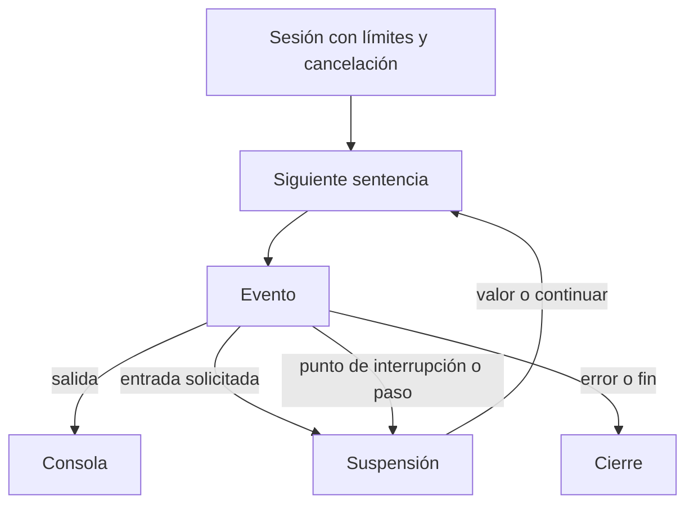
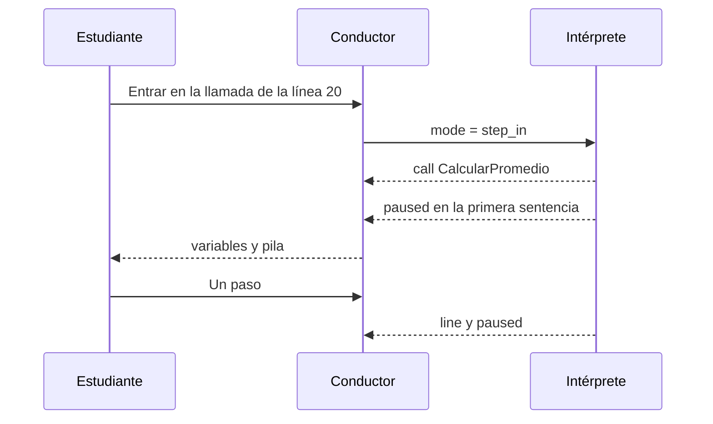

# Intérprete, depurador y ejecución segura

Estado: el motor y el depurador están en el runner cuando los servicios corren en contenedores. En la máquina, sin ese compose, siguen en el proceso de Django. La configuración de producción no está activa. El lexer acepta la grafía española y la inglesa de las palabras reservadas antes de construir el AST. El recorrido del intérprete no depende del idioma de la cuenta.

## 1. Un solo motor

El intérprete recorre el AST y produce eventos. El botón Ejecutar, el depurador y las pruebas usan el mismo recorrido. No hay un segundo motor de ejecución. Traducir el algoritmo a Python u otro lenguaje emite texto a partir de ese árbol y no lo recorre.



Interfaz prevista:

```python
def execute(program: Program, profile: LanguageProfile, limits: Limits) -> Iterator[RuntimeEvent]:
    ...
```

El conductor agota el iterador. Cuando llega `InputRequested` o `Paused`, guarda el estado de la sesión y deja de pedir eventos hasta la orden siguiente. La sesión es serializable en el proceso del runner: pila de marcos, instrucción actual, contadores y generador reanudable. No se guarda dentro de PostgreSQL el estado vivo de la pila.

## 2. Eventos

```python
@dataclass(frozen=True)
class RuntimeEvent:
    kind: Literal[
        "started",
        "line",
        "output",
        "input_requested",
        "input_rejected",
        "paused",
        "call",
        "return",
        "error",
        "finished",
    ]
    line: int | None
    column: int | None
    scope: str | None
    payload: dict[str, object]
```

Ejemplo hacia el navegador, ya filtrado para no enviar estructuras enormes:

```json
{
  "event": "line",
  "execution_id": "9b1c1d2a-7e0e-4f5a-9c1a-6d0e2f3a4b5c",
  "line": 12,
  "column": 5,
  "scope": "CalcularPromedio",
  "variables": {"suma": "35", "contador": "5"},
  "call_stack": ["Ejemplo", "CalcularPromedio"]
}
```

Los valores viajan como texto canónico, el mismo que usa `Escribir`. Un arreglo grande no se inyecta entero en cada línea: el evento lleva un resumen (`rangos` y `celdas`) y el panel pide un tramo con la orden de inspección.

Canal: **SSE** desde `GET /api/v1/executions/{id}/events/`. Las órdenes del estudiante (entrada, pausa, continuar, un paso, entrar, salir, detener) son `POST`. En la máquina, el mismo proceso de Django produce los eventos y los entrega. En los contenedores de desarrollo, Nginx publica ese camino con `proxy_buffering off` y Redis hace de bus entre Gunicorn y el runner. El esquema es el de producción; el módulo `config.settings.production` no se carga.

En la aplicación de escritorio el canal es `GET /local/v1/sessions/{id}/events/`, servido por `local_host`. El laboratorio usa `GET /local/v1/lab/runs/{id}/events/`. El sobre de eventos es el mismo. Ese proceso no escribe `executions.Execution`: la cuenta y el fuente siguen en la API.

Un `Leer` aceptado también emite `output`, con el texto guardado y un salto de línea, antes de seguir. La consola y el campo `execution.output` lo muestran en ese orden, junto a lo que escriba `Escribir`. Un texto rechazado emite `input_rejected`, no `output`, y la petición se repite. El eco cuenta para `max_output_chars`.

Los eventos de depuración no requieren WebSocket. Si más adelante el retardo o el número de conexiones lo pide, el mismo sobre JSON se puede mudar a WebSocket sin cambiar el intérprete.

## 3. Sesión de ejecución

```python
@dataclass
class Limits:
    max_instructions: int = 100_000
    max_time_ms: int = 5_000
    max_call_depth: int = 100
    max_array_cells: int = 10_000
    max_string_length: int = 100_000
    max_output_chars: int = 256_000

@dataclass
class Session:
    profile: LanguageProfile
    limits: Limits
    frames: list[Frame]
    instruction_count: int
    output_chars: int
    started: float
    cancel: Cancellation
    breakpoints: set[int]
    mode: Literal["run", "step_over", "step_in", "step_out"]
```

En cada sentencia, y también en el cierre de cada iteración, se comprueba:

- cancelación pedida por el usuario;
- número de instrucciones;
- tiempo monotónico;
- profundidad de la pila;
- celdas ya reservadas;
- caracteres ya escritos.

Al superar un tope, el evento `error` usa `E0410` (instrucciones), `E0411` (tiempo), `E0412` (profundidad), `E0413` (memoria lógica) o `E0414` (salida). El mensaje de instrucciones, si ocurre dentro de un ciclo, nombra la línea del `Mientras`, `Repetir` o `Para`.

La biblioteca estándar no abre archivos, sockets ni procesos. No recibe `os.environ`. `Aleatorio` usa un generador de la sesión.

## 4. Depurador

El depurador es el conductor del mismo iterador.

| Orden | Comportamiento |
| --- | --- |
| Ejecutar | `mode = run`. Se detiene en puntos de interrupción, en `Leer` y al terminar |
| Pausar | la bandera de cancelación suave corta en la siguiente frontera de sentencia |
| Continuar | igual que ejecutar, desde la pausa |
| Detener | cancelación definitiva y estado `cancelled` |
| Reiniciar | nueva sesión con el mismo fuente y los mismos puntos de interrupción |
| Un paso | ejecuta la sentencia actual y vuelve a pausar; una llamada cuenta como un paso |
| Entrar | si la sentencia es una llamada, pausa en la primera sentencia del llamado |
| Salir | continúa hasta volver al marco anterior |

Puntos de interrupción: conjunto de números de línea sobre el fuente de esa ejecución. Una línea sin sentencia ejecutable se acepta y se advierte; no detiene.

En cada pausa el conductor puede leer:

- línea actual;
- variables del marco activo;
- un tramo de cualquier arreglo vivo;
- pila de llamadas con nombre y línea;
- historial de salida ya emitido;
- resultado de la última condición evaluada, guardado en el evento `line` cuando la sentencia es un rombo.

La velocidad de la ejecución animada la regula el cliente: pide `run` con un retardo entre eventos, o encadena pasos. El servidor no duerme para animar. Así un cliente desconectado no deja un hilo bloqueado en `sleep`.



## 5. Aislamiento

### Desarrollo

`InProcessRunner` vive en el proceso de `runserver` y llama a `execute` con `Limits`. Es el ejecutor de la máquina cuando `TRAZA_RUNNER` no está definido. Sirve para probar el lenguaje sin Redis.

Condiciones para que exista:

- solo con `settings.development`;
- si `DEBUG` es falso, arrancar con este runner es un error de configuración;
- el manual de desarrollo lo marca como distinto de producción.

Aunque esté en el mismo proceso, el intérprete sigue sin `eval` y sin acceso a disco o red. Un ciclo infinito lo corta el límite de instrucciones y el de tiempo. Eso no sustituye el aislamiento del sistema operativo: un fallo del propio intérprete compartiría el proceso con Django.

### Contenedores de desarrollo y, más adelante, producción


Este dibujo ya es el del compose. Gunicorn usa la configuración de desarrollo. El mismo dibujo servirá en el servidor cuando se active `config.settings.production`. Mailpit está en la red `web` y no en la del runner: el intérprete no envía correo. Las pasadas del laboratorio, en contenedores, usan este mismo bus y no escriben `executions.Execution`.

El contenedor `runner`:

- imagen distinta, con Python y `language_core` únicamente;
- usuario no root;
- sistema de archivos de solo lectura y `tmpfs` pequeño en `/tmp`;
- sin credenciales de PostgreSQL ni secretos de Django;
- credencial de Redis limitada a las claves de ejecución;
- red interna de Compose, sin salida pública;
- `cap_drop: ALL`, `no-new-privileges`, límite de procesos, de memoria y de CPU;
- el límite de tiempo del intérprete corta la sesión. La memoria, la CPU y el número de procesos los corta el contenedor.

El fuente viaja en el mensaje de Redis, no en un archivo del servidor web. El runner publica un latido. El healthcheck del servicio comprueba ese latido.

Celery no interviene. La sesión es interactiva y tiene afinidad con un worker vivo hasta que la ejecución termina, se cancela o vence. Un worker toma la ejecución con un bloqueo en Redis para que dos workers no la avancen a la vez.

## 6. Diferencia que hay que documentar en el despliegue

| | Máquina | Contenedores de desarrollo | Servidor, más adelante |
| --- | --- | --- | --- |
| Proceso | el de Django | contenedor `runner` | contenedor `runner` |
| Ajustes | `development`, ejecutor en proceso | `development`, `TRAZA_RUNNER=redis` | `production` |
| Aislamiento | límites lógicos | límites lógicos y del contenedor | límites lógicos y del contenedor |
| Bus | llamada directa | Redis | Redis |
| Eventos al navegador | el mismo SSE | el mismo SSE, sin buffer en Nginx | el mismo SSE, con TLS |
| Si el intérprete tiene un defecto grave | puede afectar a `runserver` | queda en el contenedor, que se puede matar | queda en el contenedor, que se puede matar |

## 7. Órdenes y estados

```text
queued → running → waiting_input → running → completed
                 → paused → running
                 → error
                 → timeout
                 → cancelled
```

Una ejecución terminada no acepta más entradas. El cliente, al recibir `finished` o `error`, cierra el canal SSE.
