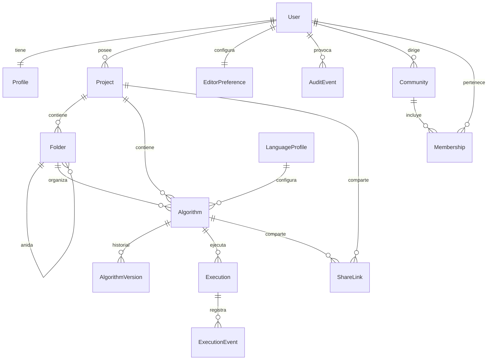

# Modelo de datos

Estado: migrado. Fecha de referencia: 2026-10-14. El diccionario para consultar, con tipo y longitud de cada campo, está en [diccionario-de-datos.md](diccionario-de-datos.md). El mapa de procesos está en [arquitectura.md](arquitectura.md). Las comunidades de docentes están en `classroom`. Las actividades y las entregas del aula no. El laboratorio tiene tablas propias en `learning`, con el catálogo de conceptos, la ruta Fundamentos de treinta y cuatro retos, el banco y las rutas que arma un docente. `accounts.User.email_confirmed` llegó en la migración `0004_user_email_confirmed`.

Motor: PostgreSQL. Claves públicas: UUID versión 4. Claves internas de alto volumen: entero de 64 bits. Las marcas de tiempo son `timestamptz`.

El borrado de proyectos, carpetas y algoritmos es lógico con `deleted_at`. Las filas hijas se conservan para poder restaurar. Los índices de unicidad de nombres son parciales: `WHERE deleted_at IS NULL`.

## 1. Vista general

El laboratorio no cuelga de `Algorithm`. `LearningPath`, `Challenge`, `ChallengeAttempt` y `Practice` forman otro grupo, descrito en la sección 6.1. Una ruta de docente puede asignarse a una `Community` o a un alumno mediante `PathAssignment`.

## 2. Usuario y perfil

No se usa el usuario por defecto de Django. Cambiarlo después de la primera migración es costoso.

`accounts.User`, subclase de `AbstractUser`:

- `email`: único, es el `USERNAME_FIELD`;
- `email_confirmed`: verdadero en las cuentas ya existentes y en el alta sin buzón; en los contenedores queda en falso hasta abrir el enlace;
- `username`: no se usa para entrar; puede quedar nulo;
- contraseña: solo el hasher de Django.

`accounts.Profile`:

- `user`: uno a uno, borrado en cascada;
- `display_name`: cadena corta;
- `institution`: cadena opcional;
- `role`: `student` o `teacher`. Si el alta no lo elige, queda `student`. Se cambia con `PATCH /api/v1/auth/me/`;
- `points`: entero. Sube una vez al terminar un reto. El puesto no es una columna: es cuántos perfiles tienen más puntos, más uno;
- `created_at`, `updated_at`.

`editor.EditorPreference`, uno a uno con el usuario:

- `theme`: `light` o `dark`;
- `font_size`: entero entre 12 y 28;
- `keymap`: `default` al inicio;
- `indent_size`: entero;
- `autosave`: booleano, verdadero por defecto;
- `locale`: `es` o `en`. Arranca en `es`. Llegó en `0002_preference_locale_and_language`. Cambia los textos de la interfaz y la grafía con la que el editor muestra las palabras reservadas. No reescribe un fuente ya guardado;
- `require_semicolons` e `index_base`: la elección de la cuenta. Un algoritmo nuevo las copia. Los que ya existen conservan su texto y sus propias opciones.

## 3. Proyectos y algoritmos

`projects.Project`

| Campo | Notas |
| --- | --- |
| id | UUID, clave primaria |
| owner | FK a User, `PROTECT` |
| name | 1..120 caracteres |
| description | texto, vacío permitido |
| visibility | `private` o `unlisted` |
| created_at, updated_at, deleted_at | |
| unique | `(owner, name)` donde `deleted_at` es nulo |

`projects.Folder`

| Campo | Notas |
| --- | --- |
| id | UUID |
| project | FK, `CASCADE` |
| parent | FK a sí misma, nulo si es raíz, `CASCADE` |
| name | 1..120 |
| created_at, deleted_at | |
| unique | `(project, parent, name)` donde no está borrada |

La profundidad se valida en el servicio, con un tope de 8, para evitar un ciclo de carpetas. Además se rechaza elegir como padre a un descendiente.

`projects.Algorithm`

| Campo | Notas |
| --- | --- |
| id | UUID |
| project | FK, `CASCADE` |
| folder | FK nula, `SET NULL` si se bordea la carpeta de forma física; con borrado lógico no se anula |
| owner | FK a User, `PROTECT`, desnormalizada; debe coincidir con el dueño del proyecto |
| name | 1..120 |
| source | texto, tope de aplicación 64 KiB |
| language_profile | FK, `PROTECT` |
| language_options | JSON. Vacío significa «usar el perfil». Hoy guarda `require_semicolons` y `index_base` |
| profile_snapshot | JSON, copia de las banderas usadas en la última ejecución |
| current_version | entero, empieza en 1 al primer guardado explícito; 0 si solo hay autoguardado |
| flowchart | JSON nulo. Caché `{source_hash, graph}`. El resumen es `v4`, el perfil, el punto y coma, la base de índices y el fuente |
| created_at, updated_at, deleted_at | |
| unique | entre filas vivas: `(project, name)` si no hay carpeta, y `(project, folder, name)` si la hay |

El fuente vivo está en `Algorithm.source`. El autoguardado lo actualiza y no crea una versión en cada pulsación.

`projects.AlgorithmVersion`

| Campo | Notas |
| --- | --- |
| id | entero |
| algorithm | FK, `CASCADE` |
| number | entero positivo |
| source | texto |
| message | cadena opcional |
| created_by | FK a User, `PROTECT` |
| created_at | |
| unique | `(algorithm, number)` |

Se crea una versión al guardar de forma explícita, al restaurar una versión anterior y al ejecutar, si el fuente difiere de la última versión. Restaurar copia el fuente de esa versión al algoritmo y abre un número nuevo; no reescribe la historia.

`language.LanguageProfile`

| Campo | Notas |
| --- | --- |
| id | entero |
| key | único: `strict`, `flexible`, y los que se añadan |
| name | nombre visible |
| config | JSON validado por un esquema |
| is_system | verdadero para los perfiles de fábrica; no se borran |

El esquema de `config` repite las banderas de `LanguageProfile` del núcleo: `index_base`, `require_semicolons`, `require_declarations`, `implicit_widening`, `allow_equals_assignment`, `allow_globals`, `beginner_warnings`, `keyword_aliases`, límites de instrucciones, tiempo, profundidad, celdas y tamaño de salida.

## 4. Ejecución

`executions.Execution`

| Campo | Notas |
| --- | --- |
| id | UUID |
| algorithm | FK, `PROTECT` |
| version_number | entero nulo si se ejecutó un autoguardado sin versión |
| user | FK, `PROTECT` |
| status | `queued`, `running`, `waiting_input`, `paused`, `completed`, `error`, `cancelled`, `timeout` |
| limits | JSON con los topes aplicados |
| instruction_count | entero |
| started_at, finished_at | |
| índice | `(user, started_at desc)`, `(algorithm, started_at desc)`, `(status)` |

`executions.ExecutionEvent`

Una fila por salida, entrada aceptada, error y fin. No se persiste cada `line_executed`: eso saturaría la base durante un ciclo. Esos eventos van por SSE. En la máquina los emite el proceso de Django. En los contenedores, Redis es el bus y Gunicorn los reenvía. Sí se guarda el historial de consola, que el estudiante espera encontrar después. El dato que un `Leer` acepta queda en ese historial como salida.

| Campo | Notas |
| --- | --- |
| id | entero |
| execution | FK, `CASCADE` |
| sequence | entero |
| kind | `output`, `input`, `error`, `status` |
| text | texto acotado |
| line, column | nulos si no aplican |
| code | código de diagnóstico, nulo en la salida normal |
| unique | `(execution, sequence)` |

El error de ejecución no necesita otra tabla. Un evento `kind=error` guarda código, mensaje, línea, columna y sugerencia en columnas propias: `code`, `text`, `line`, `column`, `suggestion`.

## 5. Compartir y auditoría

`projects.ShareLink`

| Campo | Notas |
| --- | --- |
| id | UUID |
| algorithm | FK nula, `CASCADE` |
| project | FK nula, `CASCADE` |
| token_hash | hash del token; el valor en claro se muestra una vez |
| created_by | FK, `PROTECT` |
| expires_at | nulo si no caduca |
| revoked_at | |
| created_at | |
| check | exactamente uno de `algorithm` o `project` es no nulo |

`audit.AuditEvent`

| Campo | Notas |
| --- | --- |
| id | entero |
| actor | FK nula si el actor ya no existe, `SET NULL` |
| action | cadena corta: `auth.login`, `algorithm.delete`, `share.create`, `execution.start` |
| object_type | cadena |
| object_id | UUID en texto |
| metadata | JSON sin secretos ni fuente completo |
| ip_address | |
| created_at | |
| índice | `(actor, created_at desc)`, `(object_type, object_id)` |

## 6. Perfil y comunidades

`accounts.Profile.role` es `student` o `teacher`. Si no se elige al crear la cuenta, queda `student`. Se puede cambiar con `PATCH /api/v1/auth/me/`.

Una comunidad pertenece a un docente. Solo él la crea, la lista y la borra. El nombre es único entre las suyas. Hay un tope de 30 comunidades y de 200 personas por comunidad.

`classroom.Membership` une la comunidad con un usuario que ya tiene cuenta. No se registran personas desde la comunidad. El docente busca por nombre o correo, entre alumnos y otros docentes, y agrega el resultado a una comunidad suya. No puede agregarse a sí mismo. La lista de alumnos y la de docentes salen del perfil actual de cada miembro.

No hay actividades ni entregas en el aula. Esas tablas siguen sin existir.

## 6.1 Laboratorio

El laboratorio no usa las tablas de proyectos ni de ejecuciones. Vive en `server/apps/learning`, con los modelos repartidos en `models/content.py`, `models/attempts.py`, `models/mastery.py` y `models/practice.py`.

Hay rutas, unidades, retos, casos de prueba, pistas, intentos, fotos del workspace, usos de pista, predicciones, reflexiones, conceptos y dominio. La migración `0002_seed_concepts` carga seis conceptos (`variable`, `assignment`, `io`, `operator`, `if`, `while`). `0003_seed_path` carga la ruta Fundamentos. `0006_control_challenges` suma `Si` y `Mientras`. `0007_switch_for_repeat` suma `Segun`, `Para` y `Repetir`. Cada reto puede llevar `time_limit_seconds`; si es nulo, no hay límite. Al cerrar un intento, terminado o sin tiempo, se guarda `elapsed_seconds`. Un intento apunta a un usuario y no es una fila de `executions.Execution`. `Practice` guarda una práctica libre de ese usuario: nombre único entre las suyas, el JSON del lienzo y el pseudocódigo. Hay un tope de 40. No es un algoritmo del banco de trabajo.

## 7. Políticas de borrado

| Acción | Efecto |
| --- | --- |
| Papelera de algoritmo o proyecto | `deleted_at` ahora. Deja de listarse. Se puede restaurar |
| Vaciar papelera | borrado físico del algoritmo, sus versiones, eventos de ejecución y enlaces |
| Borrar usuario | se rechaza si posee proyectos vivos. Primero debe vaciarlos. Luego se anonimiza la auditoría (`actor` nulo) |
| Borrar perfil de lenguaje de sistema | prohibido |

## 8. Límites que también son datos

El servicio rechaza, antes de llamar al núcleo:

- fuente de más de 64 KiB;
- nombre vacío o con caracteres de control;
- más de 200 algoritmos vivos por proyecto;
- más de 50 proyectos vivos por usuario.

Esas cifras son de arranque y viven en ajustes, no repartidas por los modelos.
