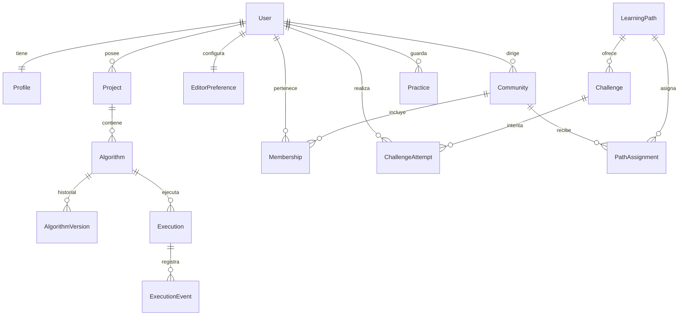

# Arquitectura de datos

Fecha de referencia: 2026-10-17. La comunidad y la membresía guardan si la traducción de código está habilitada. El CSV de notas y el del banco de retos no son tablas. Motor: PostgreSQL 16. La traducción no se almacena. La ventana de escritorio lee y escribe las mismas tablas a través de la API. El detalle de columnas, índices y borrado está en [modelo-de-datos.md](../modelo-de-datos.md).

Hay dos grupos que no se mezclan. El banco de trabajo cuelga de `Algorithm`. El laboratorio cuelga de `Challenge` y de `Practice`. Un intento no es una fila de `Execution`.

| Grupo | Qué se guarda | Qué no se guarda |
| --- | --- | --- |
| Cuenta | Correo, confirmación, perfil, rol y puntos | La contraseña en claro |
| Editor | Fuente vivo, versiones, enlace con el hash del token, caché del grafo y el idioma de la cuenta (`es` o `en`) | Cada línea del depurador. El idioma no reescribe el fuente |
| Ejecución | Estado, límites, salida, entradas aceptadas y errores | La pila viva de la sesión |
| Laboratorio | Rutas, retos, fotos del lienzo, pistas usadas, predicción y reflexión | Una fila de `Execution` |
| Auditoría | Acción, actor, objeto y dirección | El fuente completo ni secretos |

Claves públicas de proyecto, algoritmo, ejecución, comunidad y laboratorio: UUID versión 4. Eventos y versiones: entero. Marcas de tiempo: `timestamptz`. El borrado de proyectos y algoritmos es lógico con `deleted_at`.

Redis guarda órdenes, eventos en tránsito, el latido del runner y la caché de límites. No es el sistema de registro.

Volver al [índice](indice.md).
