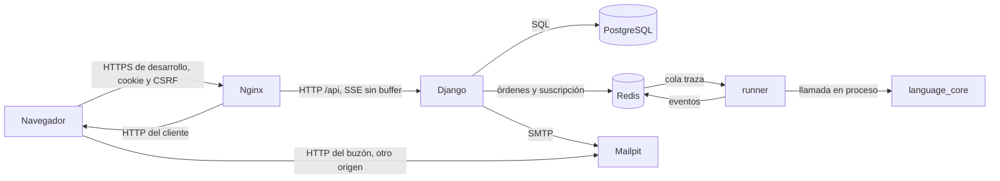

# Arquitectura de integración

Fecha de referencia: 2026-10-19. No hay un bus de empresa ni un proveedor de correo externo. Las integraciones son los contratos entre las piezas del propio sistema, y el proxy de la ventana de escritorio hacia la API.

| Contrato | Protocolo | Qué viaja |
| --- | --- | --- |
| Navegador y API | HTTP JSON, sesión, CSRF | Alta, proyectos, laboratorio y órdenes de depuración |
| Canal de eventos | SSE, `proxy_buffering off` | Línea, salida, pausa, entrada y fin |
| API y base | SQL del ORM | Estado durable |
| API y runner | Redis, claves `traza:*` | Orden de inicio y órdenes de control. El fuente va en el mensaje |
| Runner y núcleo | Llamada Python | AST y eventos. El runner no importa Django |
| API y buzón | SMTP al puerto `1025` | Confirmación y restablecimiento |
| Navegador y buzón | HTTP en `127.0.0.1:8025` | Lectura humana del mensaje. No pasa por Nginx |
| Esquema | OpenAPI en `GET /api/schema/` | Contrato vivo de la API |
| Traducción | `POST /api/v1/algorithms/{id}/translate/` o `POST /local/v1/translate` | Diagnósticos y, sin errores, un programa por lenguaje. No hay ejecución. 403 si el docente o el nivel la apagaron |
| Nivel | `GET /api/v1/auth/me/` y `/api/v1/billing/` | El plan viaja con la cuenta. El administrador define niveles. No hay cobro automático |
| Aplicación | Cabecera `X-Aulivana-FCDdesign-Client: desktop` | Sin ella, y si el navegador no está permitido, el resto de `/api/v1/` responde 403 |
| Notas | `GET /api/v1/learning/roster/{id}/progress/` | CSV de la ruta. No se guarda |
| Retos | `GET /api/v1/learning/challenges/csv/?tipo=&contenido=retos&banco=` y `POST /api/v1/learning/challenges/csv/` | La descarga sale por tipo y por banco (`catalogo` o `concurso`). Un alumno recibe 403. La carga admite hasta 250 retos y 1 MB. Si una fila falla, no se guarda ninguna |
| Escritorio y API | `POST /local/v1/proxy`, solo rutas `/api/` | La misma JSON de la API. El token del anfitrión local no viaja al servidor |
| Escritorio y núcleo | HTTP en `127.0.0.1` con el token de arranque | Validar, traducir, ejecutar, depurar y el laboratorio |

El error de la API tiene siempre `error.code`, `error.message` y `error.details`. Un objeto privado de otra persona responde 404. El idioma de la cuenta no es un servicio: el navegador cambia la pantalla y la grafía visible, y el núcleo acepta las dos grafías al lexicar. Traducir a Python u otro lenguaje es otro contrato y no reescribe el fuente.

En la máquina, sin compose, desaparecen Redis, runner y Mailpit. Django llama a `language_core` y escribe el correo en la consola.

Volver al [índice](indice.md).
