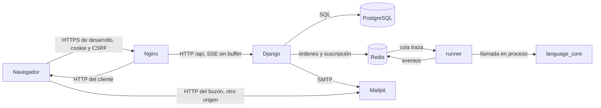

# Arquitectura de integración

Fecha de referencia: 2026-10-14. No hay un bus de empresa ni un proveedor externo. Las integraciones son los contratos entre las piezas del propio sistema.

| Contrato | Protocolo | Qué viaja |
| --- | --- | --- |
| Navegador y API | HTTP JSON, sesión, CSRF | Alta, proyectos, laboratorio y órdenes de depuración |
| Canal de eventos | SSE, `proxy_buffering off` | Línea, salida, pausa, entrada y fin |
| API y base | SQL del ORM | Estado durable |
| API y runner | Redis, claves `traza:*` | Orden de inicio y órdenes de control. El fuente va en el mensaje |
| Runner y núcleo | Llamada Python | AST y eventos. El runner no importa Django |
| API y buzón | SMTP al puerto `1025` | Confirmación y restablecimiento |
| Navegador y buzón | HTTP en `127.0.0.1:8025` | Lectura humana del mensaje. No pasa por Nginx |
| Esquema | OpenAPI en `GET /api/schema/` | Contrato vivo de la API |

El error de la API tiene siempre `error.code`, `error.message` y `error.details`. Un objeto privado de otra persona responde 404. El idioma no es un servicio: el navegador traduce la pantalla y la grafía visible, y el núcleo acepta las dos grafías al lexicar.

En la máquina, sin compose, desaparecen Redis, runner y Mailpit. Django llama a `language_core` y escribe el correo en la consola.

Volver al [índice](indice.md).
