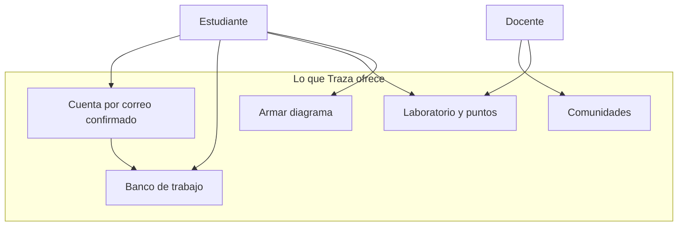

# Arquitectura de negocio

Fecha de referencia: 2026-10-14. Traza enseña programación estructurada. El canónico del lenguaje es el español y la cuenta puede ver la interfaz y las palabras reservadas en inglés. El estudiante escribe pseudocódigo, lo valida, lo ejecuta, lo depura y ve el diagrama. El docente agrupa cuentas ya registradas y sigue el avance del laboratorio.

## Actores

| Actor | Objetivo |
| --- | --- |
| Estudiante | Practicar algoritmos con diagnóstico de línea y columna, consola y diagrama |
| Docente | Formar comunidades, publicar rutas y ver puntos y puesto |
| Plataforma | Conservar la cuenta, el fuente y el intento, y ejecutar el programa fuera del proceso web |

Quedan fuera del negocio actual las actividades y las entregas del aula, la orientación a objetos, los archivos del pseudocódigo y la concurrencia.

## Capacidades

## Reglas de negocio

- El identificador es el correo. En los contenedores la sesión no empieza hasta abrir el enlace.
- Cada cuenta nueva recibe los ejemplos 1 a 13.
- El perfil es estudiante o docente. Si no se elige, queda estudiante.
- Un docente no crea cuentas desde la comunidad: busca personas ya registradas.
- Los puntos de un reto se suman una sola vez. El puesto sale de comparar `Profile.points`.
- El laboratorio y el editor comparten el lenguaje. Un intento no es un algoritmo del banco de trabajo.
- El idioma de la cuenta es español o inglés. Cambia la pantalla y la grafía de las palabras reservadas. No reescribe un fuente ya guardado.
- Armar diagrama produce texto. Al abrirlo en el editor, el núcleo pasa a ser la autoridad.

Volver al [índice](indice.md).
