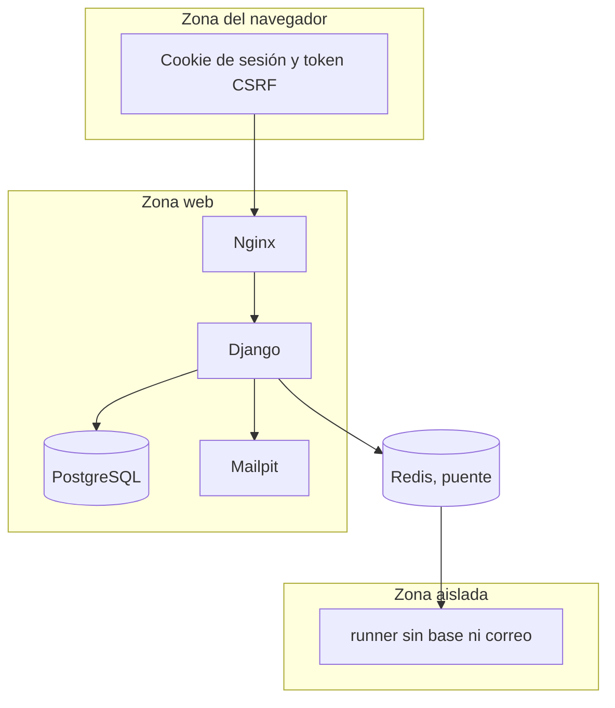

# Arquitectura de seguridad

Fecha de referencia: 2026-10-14. El perímetro de desarrollo tiene tres zonas. La de producción, cuando exista, sustituye Mailpit por un SMTP real y pone TLS delante de Nginx.

| Control | Dónde |
| --- | --- |
| Contraseña solo con el hasher de Django | `accounts` |
| Correo confirmado antes de la sesión, en contenedores | token de un solo uso ligado a `email_confirmed` |
| CSRF en los cambios de estado | middleware y cabecera `X-CSRFToken` |
| Objeto ajeno responde 404 | proyectos, intentos y comunidades |
| Tope de 64 KiB antes de lexicar | servicio, no el núcleo |
| Límite de peticiones | entrada y ejecución |
| Auditoría sin fuente completo ni secretos | `audit` |
| Credencial Redis del runner acotada a `traza:*` | ACL |
| Runner sin red pública, sin capacidades y con tope de recursos | compose |
| Cookies `Secure` y HSTS | solo `config.settings.production`, que hoy no arranca |
| SMTP de desarrollo | Mailpit no entrega fuera de la máquina |

El enlace de confirmación lleva `uid` y `token` en la query del origen público. Al confirmar, el token deja de servir. Entrar antes responde `email_unconfirmed`.

El intérprete no abre archivos del sistema, ni red, ni variables de entorno del estudiante. Los límites de instrucciones, tiempo, profundidad, celdas y salida cortan el programa. El contenedor corta memoria, CPU y procesos.

Volver al [índice](indice.md).
