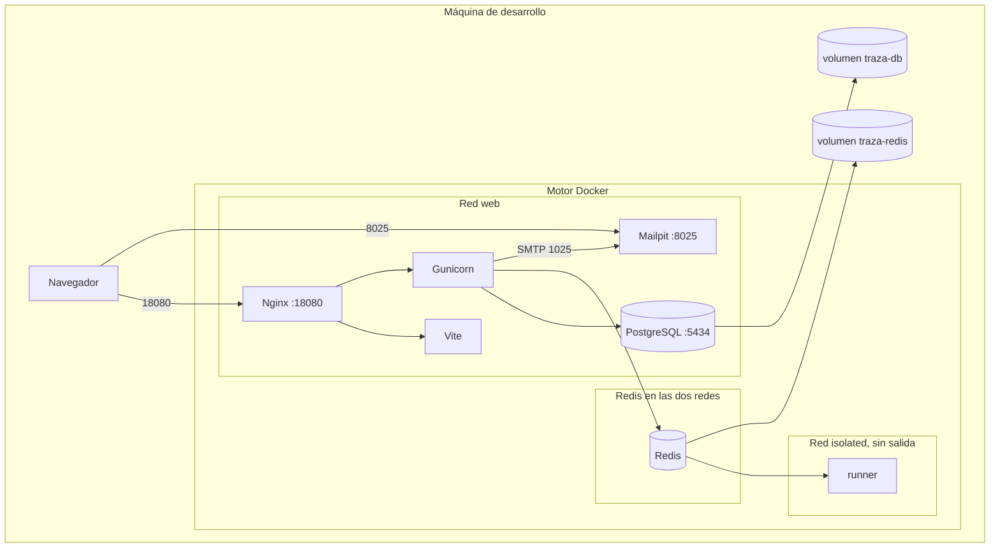

# Arquitectura física

Fecha de referencia: 2026-10-14. Todo corre en la máquina de desarrollo, dentro de Docker. No hay un servidor publicado.

| Pieza física | Puerto en el anfitrión | Disco |
| --- | --- | --- |
| Nginx | `18080` | configuración de solo lectura |
| Mailpit | `8025`. El SMTP `1025` no se publica | mensajes en memoria, tope 500 |
| PostgreSQL 16 | `5434` | volumen `traza-db` |
| Redis 7 | ninguno | volumen `traza-redis` |
| Vite, Gunicorn, runner | ninguno | el código va montado en Vite y Gunicorn. El runner no monta el servidor |

El runner usa sistema de archivos de solo lectura, `/tmp` en memoria, sin capacidades añadidas y con tope de memoria, CPU y procesos. La red `isolated` no tiene salida a internet. Redis es el único nodo en las dos redes.

En la misma máquina puede seguir el contenedor anterior `traza-pg` en `5433`. El compose no lo usa.

Volver al [índice](indice.md).
