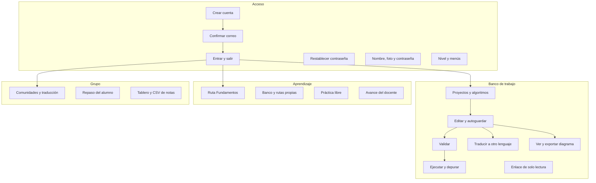

# Arquitectura funcional

Fecha de referencia: 2026-10-28. Las funciones están agrupadas por lo que la persona hace, no por el archivo que las implementa.

| Función | Resultado visible |
| --- | --- |
| Crear cuenta | Cuenta pendiente y mensaje en el buzón, o sesión inmediata en la máquina sin buzón |
| Confirmar correo | Sesión abierta y ejemplos disponibles |
| Completar | Al escribir, el editor inserta la estructura de la instrucción. Tab recorre los huecos. En solo lectura no hay lista |
| Validar | Diagnósticos con línea, columna y sugerencia. No crea una ejecución |
| Traducir | El mismo árbol, emitido en Python, JavaScript, TypeScript, Java, C, C++ y C#. No crea una ejecución |
| Actualizar | Vuelve a pedir proyectos, algoritmos, comunidades o el laboratorio. En el editor suelta el borrador local |
| Ejecutar | Consola con `Escribir` y con cada `Leer` aceptado. El nivel cuenta las ejecuciones del día. Detener corta el programa. Un ciclo se corta a 100 000 instrucciones o a 5 segundos |
| Depurar | Paso, entrar, salir, continuar, pausa, detener, reiniciar y puntos de interrupción |
| Diagrama | Figuras desde el AST, descarga SVG, PNG y PDF, e impresión. Armar diagrama y Armar Nassi-Shneiderman convierten figuras en pseudocódigo. Dimension lleva nombre y tamaño |
| Lenguajes | Aparece si el nivel lo incluye. En el navegador, Ejecutar corre en el servidor: en el público, en un contenedor aparte. En la aplicación de escritorio corre en la máquina. El código se puede pasar a un reto de construir |
| Laboratorio | Retos de clasificar, ordenar, construir y predecir. Construir con casos exige coincidir en todos y también el código de un lenguaje. Sin casos, basta con que el programa esté bien escrito y el lenguaje quede guardado. La nota se ve al avanzar. El docente define la ponderación en la ruta y puede repetir un reto ya vencido |
| Ayuda | Operadores muestra símbolos y ligadura. Manuales abre el PDF en la aplicación y lo descarga |
| Sesión | Una por cuenta. Tres fallos bloquean el correo 15 minutos. 30 minutos sin uso cierran la sesión |
| Comunidades | Pantalla propia, con un código de 6 caracteres para que el alumno entre desde Unirme. También se agregan cuentas ya registradas, con filtro y páginas de 15. Tope de 30 comunidades y 200 personas. Traducción y pegado nacen habilitados y se pueden apagar |
| Cuenta | Nombre, foto JPG o PNG y contraseña. El tipo de cuenta no cambia. La identidad muestra las ejecuciones que quedan hoy |
| Nivel | Menús, topes de proyectos y códigos, y si el navegador abre la aplicación |
| Repaso | El docente abre los proyectos del alumno en solo lectura. No crea versiones |
| Notas | Primero se elige la comunidad. Después, el tablero y el CSV de una ruta, solo con los alumnos de esa comunidad. La nota promedia puntuaciones de 0 a 100 |
| Idioma | Textos, bloques, figuras y palabras reservadas en español o en inglés. El fuente guardado no se reescribe |

El cliente tiene tres pantallas: banco de trabajo, laboratorio y armar diagrama. Las tres comparten la sesión.

Volver al [índice](indice.md).
