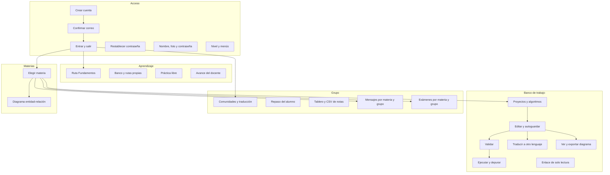

# Arquitectura funcional

Fecha de referencia: 2026-11-06. Las funciones están agrupadas por lo que la persona hace, no por el archivo que las implementa.

| Función | Resultado visible |
| --- | --- |
| Crear cuenta | Cuenta pendiente y mensaje en el buzón, o sesión inmediata en la máquina sin buzón |
| Confirmar correo | Sesión abierta y ejemplos disponibles |
| Completar | Al escribir, el editor inserta la estructura de la instrucción. Tab recorre los huecos. En solo lectura no hay lista |
| Validar | Diagnósticos con línea, columna y sugerencia. No crea una ejecución |
| Traducir | El mismo árbol, emitido en Python, JavaScript, TypeScript, Java, C, C++ y C#. No crea una ejecución |
| Actualizar | Vuelve a pedir proyectos, algoritmos, comunidades o el laboratorio. En el editor suelta el borrador local |
| Ejecutar | Consola con `Escribir` y con cada `Leer` aceptado. El nivel cuenta las ejecuciones del día. Detener corta el programa. Un ciclo se corta a 100 000 instrucciones o a 5 segundos |
| Depurar | Paso, entrar, salir, continuar, pausa, detener, reiniciar y puntos de interrupción |
| Diagrama | Figuras desde el AST, descarga SVG, PNG y PDF, e impresión. Armar diagrama y Armar Nassi-Shneiderman convierten figuras en pseudocódigo. Dimension lleva nombre y tamaño |
| Lenguajes | Aparece si el nivel lo incluye. En el navegador, Ejecutar corre en el servidor: en el público, en un contenedor aparte. En la aplicación de escritorio corre en la máquina. El código se puede pasar a un reto de construir. El editor sugiere funciones y métodos del lenguaje, con su firma, e indenta. El cuadro del lenguaje en un reto es el mismo editor |
| Laboratorio | Retos de clasificar, ordenar, construir y predecir. Construir con casos exige coincidir en todos y también el código de un lenguaje. Sin casos, basta con que el programa esté bien escrito y el lenguaje quede guardado. La nota se ve al avanzar. El docente define la ponderación en la ruta y puede repetir un reto ya vencido. El enunciado admite Markdown e imágenes, con vista previa. Desde el banco de trabajo, Pasar a un reto comprueba el pseudocódigo abierto con los casos de un construir ya empezado |
| Ayuda | Operadores muestra `<-` y `=` como asignación, `==` como igualdad, y el orden de ligadura. Manuales abre el PDF en la aplicación y lo descarga |
| Sesión | Una por cuenta. Tres fallos bloquean el correo 15 minutos. 30 minutos sin uso cierran la sesión. Una pestaña olvidada no cuenta como uso. F5, Ctrl+R y Cmd+R preguntan antes de recargar |
| Comunidades | Pantalla propia. Cada comunidad es de una materia, y el nombre se repite solo en otra materia. Un código de 6 caracteres deja entrar al alumno desde Unirme. También se agregan cuentas ya registradas, con filtro y páginas de 15. Tope de 30 comunidades y 200 personas. Traducción y pegado nacen habilitados y se pueden apagar. Cada alumno lleva un semáforo: Conectado, Conectado sin actividad o Sin conexión |
| Materias | Primera pantalla después de entrar. Fundamentos y Bases de datos se abren; Programación orientada a objetos e Ingeniería de software todavía no. Una materia que el nivel no incluye dice «Tu nivel no incluye esta materia.» Muestra los días que faltan para pagar, Exámenes con los avisos sin leer, Unirme, Mensajes y, para el docente, Comunidades. Materias, dentro de cada una, regresa ahí |
| Bases de datos | Diagrama entidad-relación en notación de Chen: entidades, relaciones, atributos, ISA, cardinalidad y participación. Proyectos, un ejemplo de accidentes y zoom. Se guarda en el navegador |
| Mensajes | Por materia y grupo. El docente escribe a todo el grupo o a un alumno; el alumno, a todo el grupo o a un docente. Hasta 2000 caracteres. Se borran al cumplir las horas que fija el administrador, 24 si no las cambia. El nivel los enciende por materia |
| Exámenes | El docente arma un examen para un grupo de una materia, con diez tipos de pregunta, fechas, duración, intentos y nota para aprobar. Lo asigna a todo el grupo o a algunos alumnos, y cada uno recibe un aviso. El alumno lo resuelve con reloj y ve su nota al entregar o al cierre. La pregunta abierta la califica el docente. CSV de calificaciones, cierre anticipado, importación de JSON, Moodle XML, GIFT, CSV y Microsoft Forms, y exportación a JSON. El nivel los enciende por materia |
| Cuenta | Nombre, foto JPG o PNG y contraseña. El tipo de cuenta no cambia. La identidad muestra las ejecuciones que quedan hoy |
| Nivel | Materias, menús por materia, topes de proyectos y códigos, y si el navegador abre la aplicación |
| Repaso | El docente elige el grupo y después el alumno, y abre sus proyectos en solo lectura. No crea versiones |
| Notas | Primero se elige la comunidad. Después, el tablero y el CSV de una ruta, solo con los alumnos de esa comunidad. La nota promedia puntuaciones de 0 a 100 |
| Idioma | Textos, bloques, figuras y palabras reservadas en español o en inglés. El fuente guardado no se reescribe |

Después de entrar, el cliente muestra las materias. Fundamentos tiene tres pantallas: banco de trabajo, laboratorio y armar diagrama. Bases de datos tiene el editor entidad-relación. Exámenes, Mensajes y Comunidades se abren también desde las materias. Todas comparten la sesión.

Volver al [índice](indice.md).
