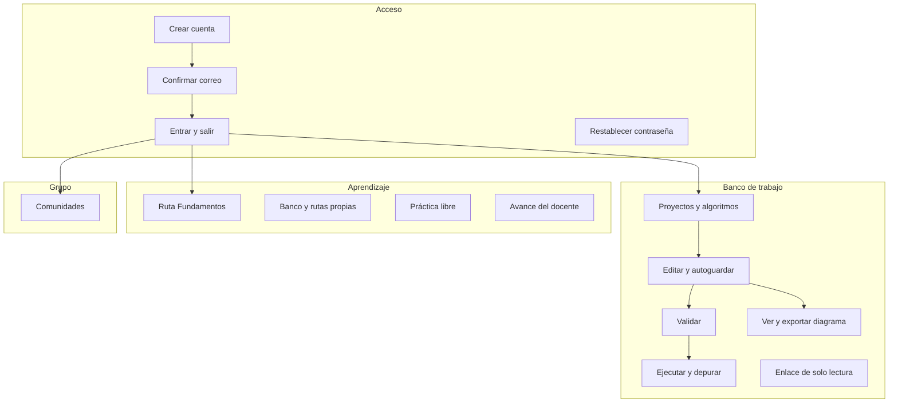

# Arquitectura funcional

Fecha de referencia: 2026-10-14. Las funciones están agrupadas por lo que la persona hace, no por el archivo que las implementa.

| Función | Resultado visible |
| --- | --- |
| Crear cuenta | Cuenta pendiente y mensaje en el buzón, o sesión inmediata en la máquina sin buzón |
| Confirmar correo | Sesión abierta y ejemplos disponibles |
| Validar | Diagnósticos con línea, columna y sugerencia. No crea una ejecución |
| Ejecutar | Consola con `Escribir` y con cada `Leer` aceptado |
| Depurar | Paso, entrar, salir, continuar, pausa, detener, reiniciar y puntos de interrupción |
| Diagrama | Figuras desde el AST, descarga SVG, PNG y PDF, e impresión |
| Laboratorio | Retos de clasificar, ordenar, construir y predecir, con el mismo intérprete |
| Comunidades | Lista de alumnos y docentes ya registrados, tope de 30 comunidades y 200 personas |
| Idioma | Textos, bloques, figuras y palabras reservadas en español o en inglés. El fuente guardado no se reescribe |

El cliente tiene tres pantallas: banco de trabajo, laboratorio y armar diagrama. Las tres comparten la sesión.

Volver al [índice](indice.md).
