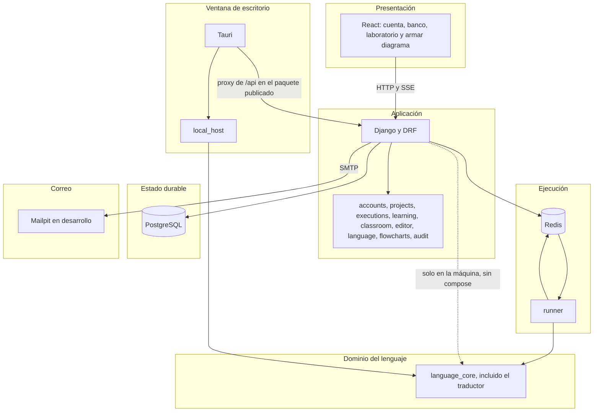

# Arquitectura lógica

Fecha de referencia: 2026-10-17. Las capas no se saltan: el navegador no llama al runner, y el runner no llama a PostgreSQL. La ventana de escritorio llama a `local_host`, que sí importa el núcleo y tampoco abre PostgreSQL.

| Capa | Responsabilidad | No hace |
| --- | --- | --- |
| Presentación | Paneles, CodeMirror, React Flow, Blockly, el modelo de armar diagrama, la grafía visible del idioma y el recuadro de traducción | Ejecutar el pseudocódigo del editor. Reescribir un fuente ya guardado al cambiar el idioma |
| Aplicación | Permisos, tamaño, límites de peticiones, persistencia, el permiso de traducir y el repaso del alumno | Interpretar en los contenedores. Guardar el código traducido. Crear una versión al ejecutar el algoritmo de un alumno |
| Dominio | Léxico, sintaxis, semántica, intérprete, depurador, diagrama, traducción a otros lenguajes, grafías en inglés y adaptador de bloques | Importar Django o Redis. Ejecutar el texto traducido |
| Ejecución | Consumir órdenes y publicar eventos | Abrir la base ni el buzón |
| Estado | Cuentas, algoritmos, intentos y auditoría | Guardar la pila viva del depurador |
| Correo | Entregar el enlace de confirmación y el de restablecimiento | Validar el programa |

En la máquina, sin compose, la aplicación llama al dominio en el mismo proceso. Esa flecha punteada no existe cuando `TRAZA_RUNNER=redis`. En la ventana de escritorio el dominio lo llama `local_host`, y la flecha hacia Django solo lleva la cuenta y los proyectos.

Volver al [índice](indice.md).
