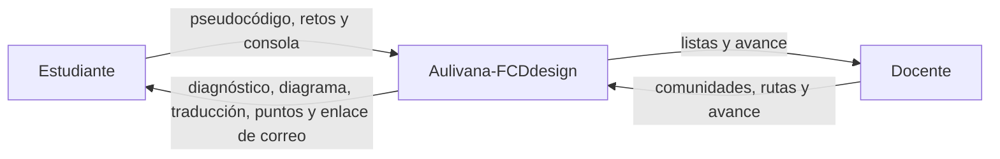
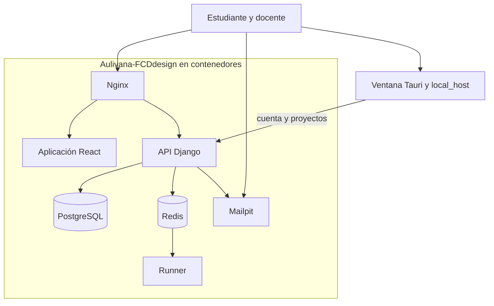
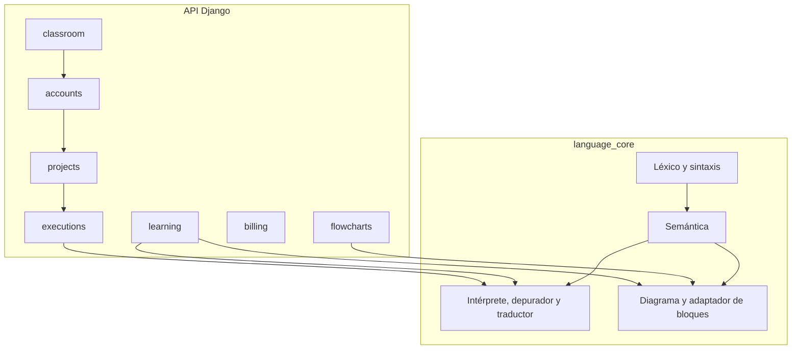

# Diagrama C4

Fecha de referencia: 2026-10-21. Tres niveles. El cuarto, el código, está en el repositorio y no se dibuja aquí.

## Nivel 1. Contexto

Aulivana-FCDdesign es el único sistema. Mailpit forma parte del entorno de desarrollo, no de un proveedor de correo. La cuenta elige español o inglés; el canónico del lenguaje sigue en español.

## Nivel 2. Contenedores

| Contenedor | Tecnología | Rol |
| --- | --- | --- |
| Nginx | nginx 1.27 | Un origen y SSE sin buffer |
| Aplicación React | Vite, TypeScript | Tres pantallas |
| API Django | Django 5.2, Gunicorn | Sesión, reglas y persistencia |
| Runner | Python, `language_core` | Interpreta lejos de la API |
| PostgreSQL | 16 | Sistema de registro |
| Redis | 7 | Bus de órdenes y eventos |
| Mailpit | 1.27 | Buzón de desarrollo |
| Ventana de escritorio | Tauri 2 y `local_host` | Interfaz y núcleo en la máquina. La API sigue en Django |

## Nivel 3. Componentes de la API y del núcleo

`accounts` no interpreta. `billing` no interpreta: guarda niveles y cierra la API cuando el navegador no está permitido. `executions` y `learning` piden el recorrido al runner, que es el único que importa el núcleo en los contenedores.

Volver al [índice](indice.md).
