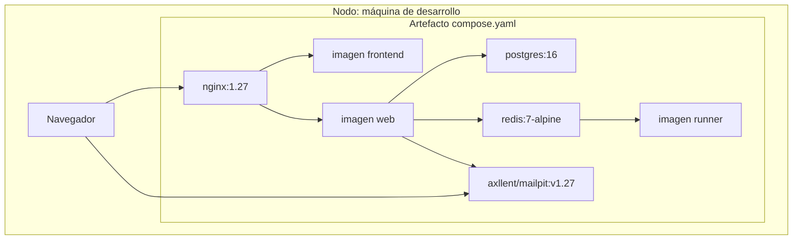

# Diagrama de despliegue

Fecha de referencia: 2026-10-14. El nodo de despliegue actual es la máquina de desarrollo. El nodo de servidor está descrito y no está activo.

| Artefacto | Imagen o build | Depende de |
| --- | --- | --- |
| `nginx` | `nginx:1.27-alpine` | `web` y `frontend` sanos |
| `frontend` | `deploy/frontend.Dockerfile` | nada |
| `web` | `deploy/web.Dockerfile` | `db`, `redis`, `runner` y `mail` sanos |
| `mail` | `axllent/mailpit:v1.27` | nada |
| `db` | `postgres:16` | nada |
| `redis` | `redis:7-alpine` | nada |
| `runner` | `deploy/runner.Dockerfile` | `redis` sano |

`web` arranca con `config.settings.development`, aplica migraciones y escucha en el puerto 8000 de su red. El healthcheck de `web` pide `GET /api/health/`, que exige la base y el latido del runner.

## Nodo futuro, no desplegado

Cuando haya un servidor, el mismo runner y el mismo Redis siguen. Cambian el borde y la configuración: TLS, `config.settings.production`, el resultado de `npm run build` en lugar de Vite, sin montar el árbol, sin puertos públicos de PostgreSQL, Redis ni runner, y un SMTP distinto de Mailpit. `production` no arranca si el ejecutor es el del proceso, si falta `REDIS_URL` o si falta `EMAIL_HOST`.

Volver al [índice](indice.md).
