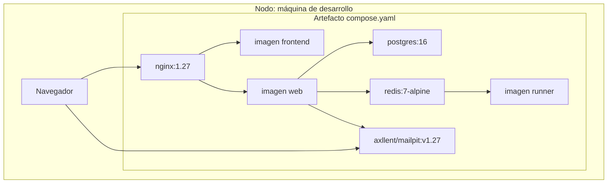
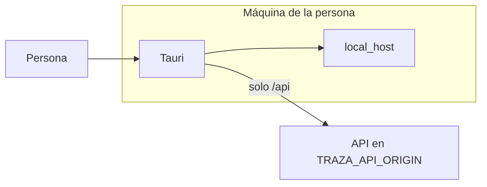

# Diagrama de despliegue

Fecha de referencia: 2026-10-27. El diagrama de abajo es el nodo de desarrollo, la máquina con `compose.yaml`. El servidor público ya está activo, con `config.settings.production`, en `https://fcdesign.aulivana.com`. Su procedimiento está en [instalacion-aws.md](../instalacion-aws.md). La ventana de escritorio es un nodo distinto: interfaz y `local_host` en la máquina de la persona, API en `TRAZA_API_ORIGIN`.

| Artefacto | Imagen o build | Depende de |
| --- | --- | --- |
| `nginx` | `nginx:1.27-alpine` | `web` y `frontend` sanos |
| `frontend` | `deploy/frontend.Dockerfile` | nada |
| `web` | `deploy/web.Dockerfile` | `db`, `redis`, `runner` y `mail` sanos |
| `mail` | `axllent/mailpit:v1.27` | nada |
| `db` | `postgres:16` | nada |
| `redis` | `redis:7-alpine` | nada |
| `runner` | `deploy/runner.Dockerfile` | `redis` sano |

`web` arranca con `config.settings.development`, aplica migraciones y escucha en el puerto 8000 de su red. El healthcheck de `web` pide `GET /api/health/`, que exige la base y el latido del runner.

## Ventana de escritorio

El paquete no lleva PostgreSQL ni Redis. El empaquetado se lanza a mano en `.github/workflows/desktop.yml`.

## Nodo público

El mismo runner y el mismo Redis siguen en `compose.servidor.yaml`. Cambian el borde y la configuración: TLS, `config.settings.production`, el resultado de `npm run build` en lugar de Vite, sin puertos públicos de PostgreSQL, Redis, runner ni lenguajes, y Gmail en lugar de Mailpit. Los lenguajes del navegador van en su propio contenedor, sin salida. `production` no arranca si el ejecutor es el del proceso, si falta `REDIS_URL`, si falta `EMAIL_HOST` o si los orígenes no son `https://`. El servicio `web` sigue montando el árbol. El detalle está en [instalacion-aws.md](../instalacion-aws.md).

Volver al [índice](indice.md).
