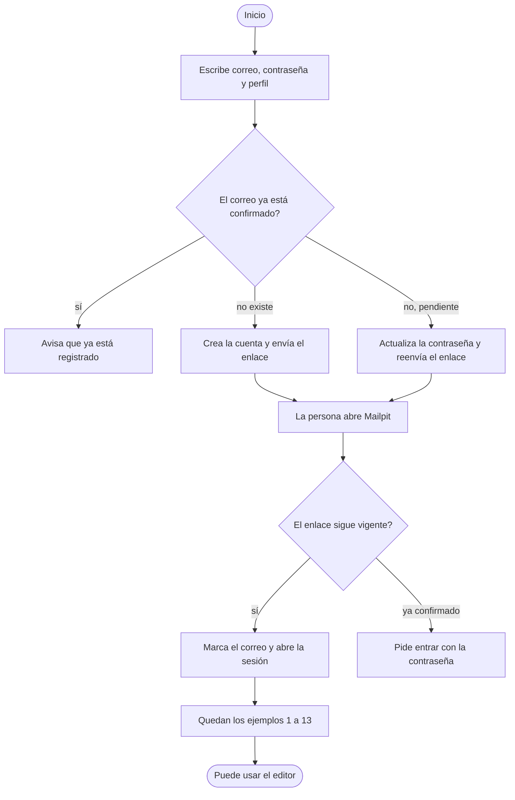
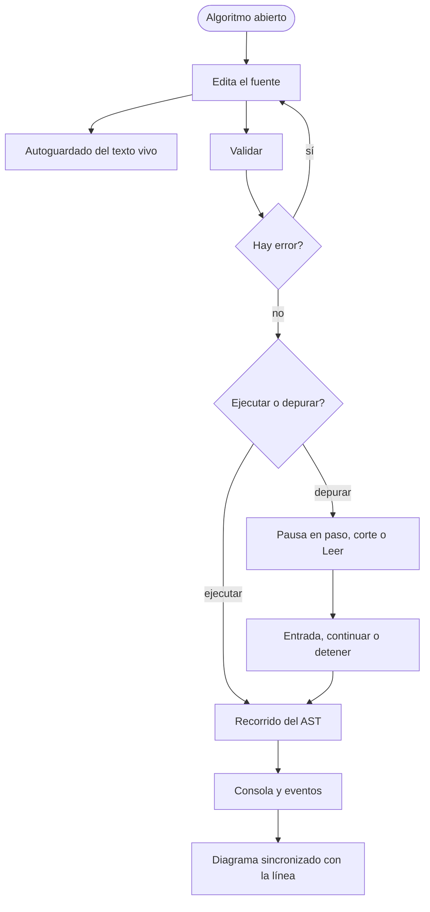
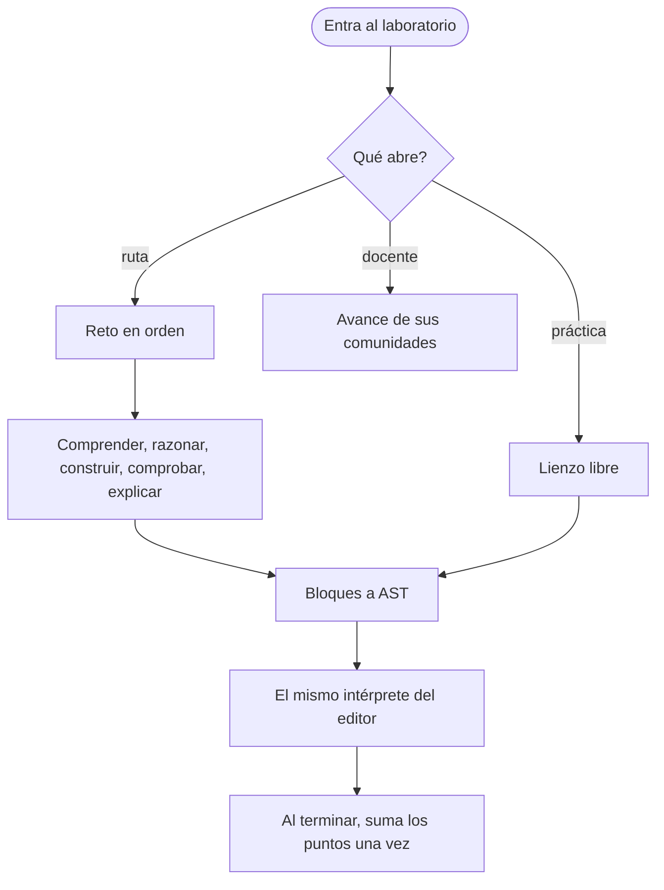

# Diagrama de procesos

Fecha de referencia: 2026-10-14. Son los procesos de negocio que el sistema sostiene, de punta a punta.

## Alta

En la máquina, sin `TRAZA_EMAIL_CONFIRMATION`, el alta entra al momento y el correo se imprime en la consola.

## Escribir y ejecutar

El editor muestra las palabras reservadas en el idioma de la cuenta. El texto que se guarda conserva la grafía que ya tenía.

## Laboratorio

Volver al [índice](indice.md).
