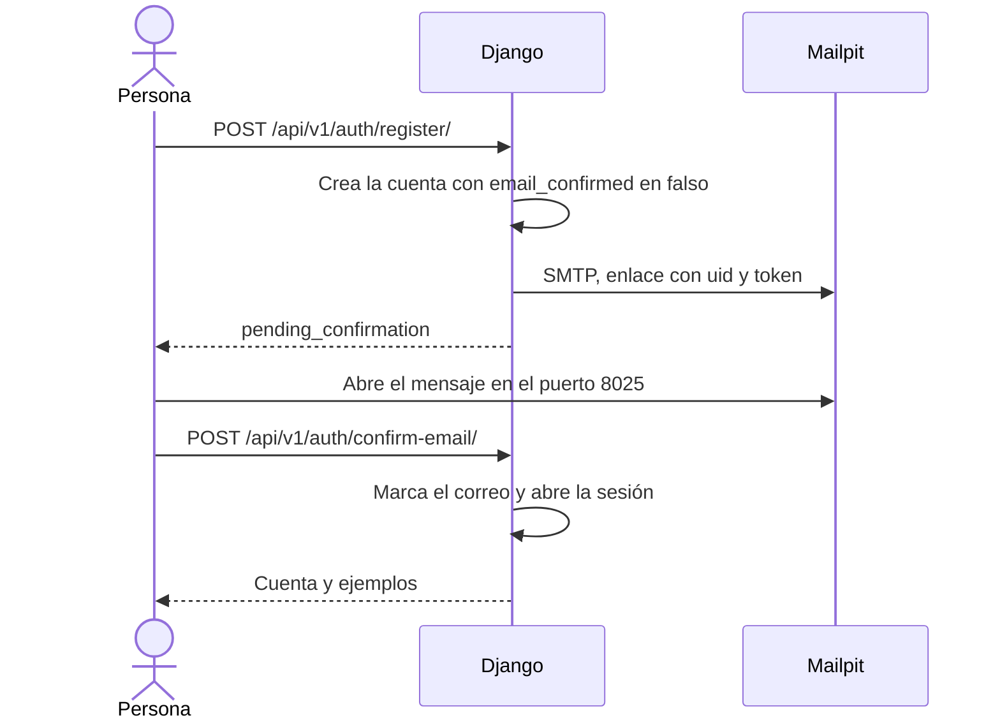
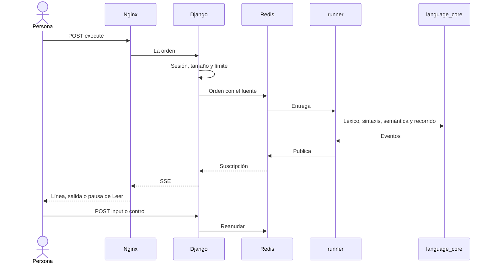
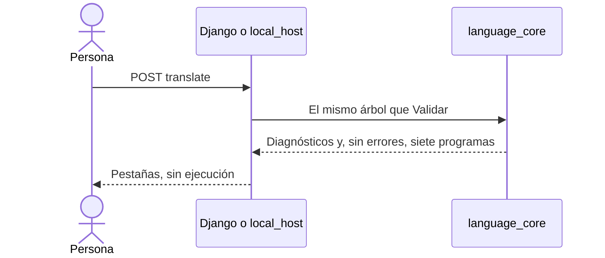

# Diagrama de secuencia

Fecha de referencia: 2026-10-17. Dos secuencias del compose de desarrollo, más la traducción. En la máquina, Django ocupa el lugar del runner y el correo sale por la consola. En la ventana de escritorio, `local_host` ocupa el lugar del runner y la traducción no abre canal.

## Confirmar el correo

Si entra antes de confirmar, `POST /api/v1/auth/login/` responde `email_unconfirmed` y no abre sesión.

## Ejecutar un algoritmo

Validar recorre léxico, sintaxis y semántica y se detiene ahí. No publica una ejecución ni abre el canal SSE.

## Traducir un algoritmo

Si el docente apagó la traducción, la respuesta es 403 y no hay programas. El repaso de un alumno usa las mismas órdenes de validar y ejecutar, sin crear una versión.

El laboratorio repite la segunda secuencia con `POST /api/v1/learning/run/` y `GET /api/v1/learning/runs/{id}/events/`. No inserta `executions.Execution`.

Volver al [índice](indice.md).
