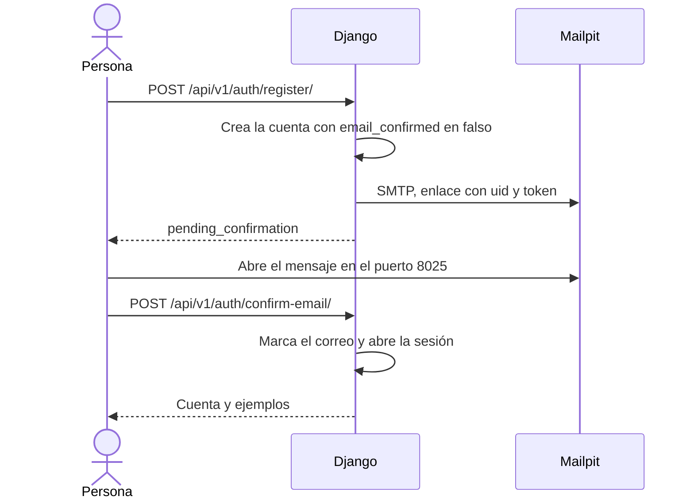
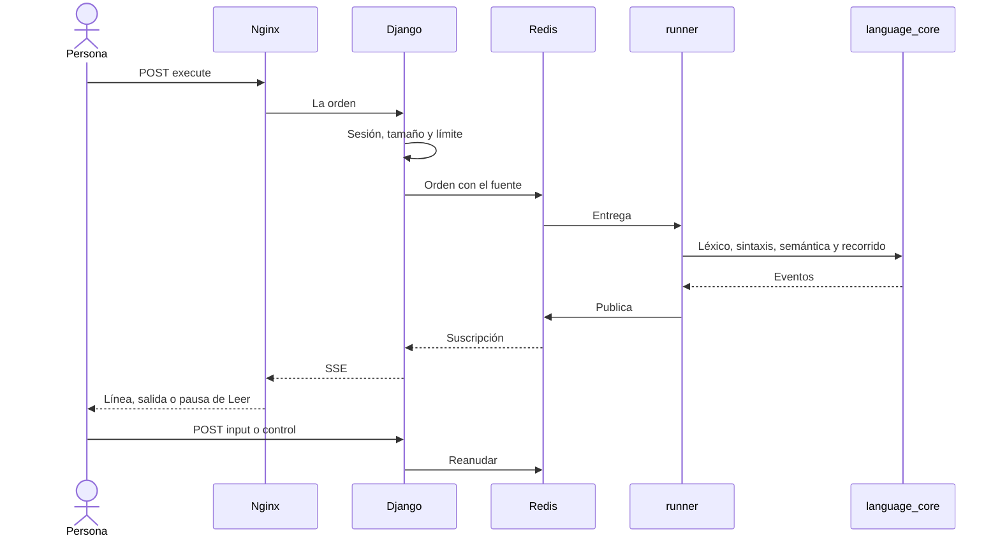

# Diagrama de secuencia

Fecha de referencia: 2026-10-14. Dos secuencias del compose de desarrollo. En la máquina, Django ocupa el lugar del runner y el correo sale por la consola.

## Confirmar el correo

Si entra antes de confirmar, `POST /api/v1/auth/login/` responde `email_unconfirmed` y no abre sesión.

## Ejecutar un algoritmo

Validar recorre léxico, sintaxis y semántica y se detiene ahí. No publica una ejecución ni abre el canal SSE.

El laboratorio repite la segunda secuencia con `POST /api/v1/learning/run/` y `GET /api/v1/learning/runs/{id}/events/`. No inserta `executions.Execution`.

Volver al [índice](indice.md).
