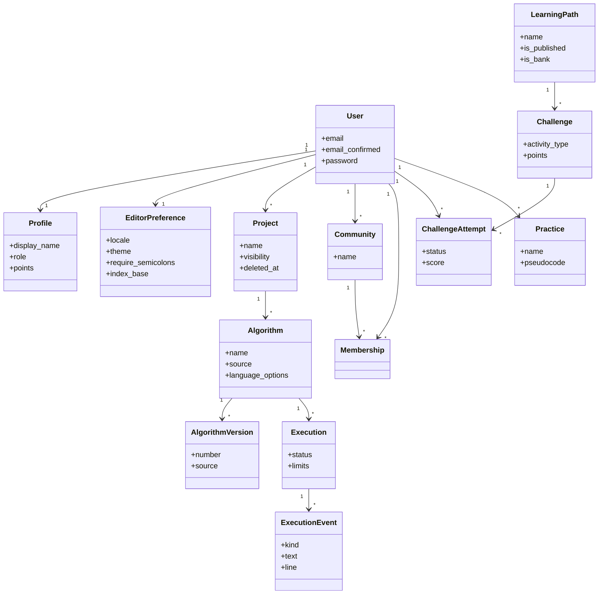
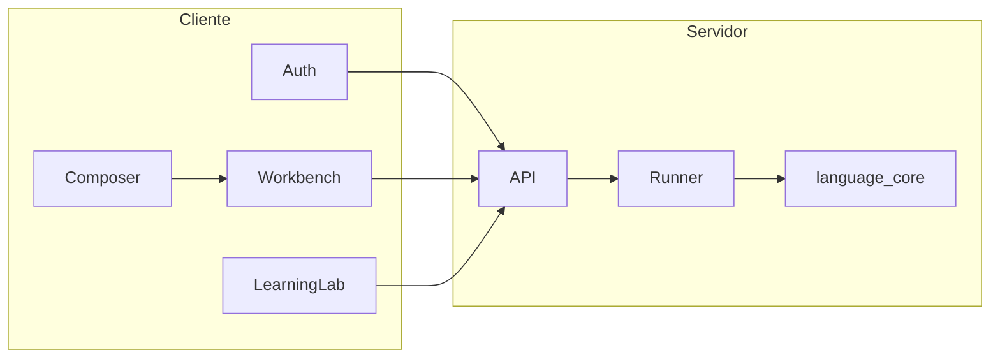

# Diagrama UML

Fecha de referencia: 2026-10-14. El diagrama de clases resume las entidades persistidas. No lista columnas de auditoría ni de infraestructura. Los atributos son los que distinguen el modelo.

Relaciones que el dibujo deja fuera para poder leerse: `Folder`, `ShareLink`, `LanguageProfile`, `PathAssignment`, `Hint`, `Concept` y `AuditEvent`. Están en [modelo-de-datos.md](../modelo-de-datos.md). `EditorPreference.locale` es `es` o `en`.

## Componentes, vista UML

`Composer` no llama al núcleo. Entrega texto al banco de trabajo, y a partir de ahí el fuente sigue el camino del editor.

Volver al [índice](indice.md).
